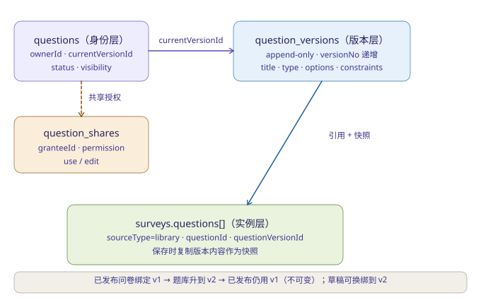
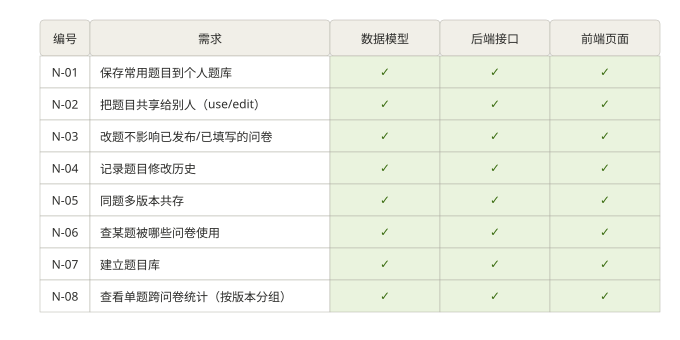
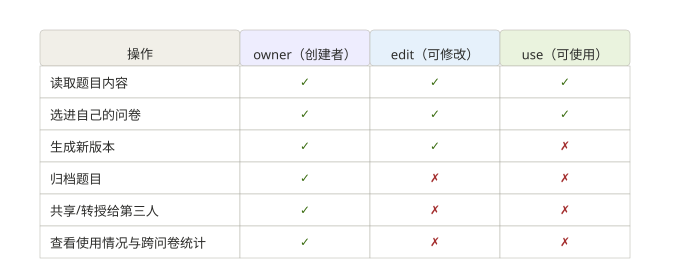

# 基于 MongoDB 的在线问卷系统 — 系统文档（第二阶段）
李麒 10245501423

| 项目 | 内容 |
|---|---|
| 文档版本 | **v2.0** |
| 版本日期 | 2026-10-29 |
| 上一版本 | v1.0 = `系统文档.md`（第一阶段完整文档，原样保留） |
| 系统名称 | 基于 MongoDB 的在线问卷系统（Survey System） |
| 阶段 | 第二阶段（在第一阶段代码基础上增量实现） |
| 对应提交项 | 七、提交内容 — 2. 文档 |
| 文档范围 | 系统说明、数据库设计、API 说明、关键逻辑说明 |
| 技术栈 | Java 21、Spring Boot 3.5.16、Spring Data MongoDB、MongoDB 8.3、原生 HTML/CSS/JavaScript |
| 配套材料 | `README.md`（环境与启动）、`db/schema.md`（Schema 明细）、`测试用例-第二阶段.md`（12 用例 / 346 步）、`测试用例-第一阶段.md` |
| 与一阶段文档的关系 | 本文档由 `系统文档.md` 改写而来，保留一阶段全部章节结构，新增内容集中在 1.12、2.5~2.7、2.11、2.14、3.8、4.12~4.17 |

## 版本记录

| 版本 | 日期 | 阶段 | 主要变更 |
|---|---|---|---|
| v1.0 | 2026-10-22 | 第一阶段 | 初版：3 个集合、16 个接口、29 条功能（F-01~F-29）、5 个前端页面。原文见 `系统文档.md` |
| v2.0 | 2026-10-29 | 第二阶段 | ① 新增 1.12、2.5~2.7、3.8、4.12~4.17；② 2.2/2.11/2.12.3/2.14 按六集合与五层完整性重写；③ 索引补到 15 条、接口补到 33 个；④ 新增三张插图；⑤ 目录按标题重建 |

**修订说明**：第二阶段共 8 条新需求（N-01 ~ N-08），全部在既有代码上增量实现，未推倒重做，也未删除任何一阶段功能。数据库层面新增三个集合，一阶段三个集合只增加可选字段；接口层面新增 17 个（Q-01 ~ Q-15、SQ-01 ~ SQ-02）；一阶段的 29 条功能（F-01 ~ F-29）全部保持可用，并有回归测试覆盖。

本文档与 `README.md`、`schema.md`、`测试用例-第二阶段.md` 共享同一套版本号（v1.0 = 第一阶段，v2.0 = 第二阶段），各文档的版本对照见 `README.md` §9.5。

---

## 目录

- [1 系统说明](#1-系统说明)
  - [1.1 项目背景与建设目标](#11-项目背景与建设目标)
  - [1.2 需求范围](#12-需求范围)
    - [1.2.1 第一阶段实现的功能（F-01 ~ F-29）](#121-第一阶段实现的功能f-01--f-29)
    - [1.2.2 第二阶段新增的 8 条需求（N-01 ~ N-08）](#122-第二阶段新增的-8-条需求n-01--n-08)
    - [1.2.3 需求的实现口径说明](#123-需求的实现口径说明)
  - [1.3 技术选型](#13-技术选型)
    - [1.3.1 不引入 Spring Security 过滤器链的原因](#131-不引入-spring-security-过滤器链的原因)
    - [1.3.2 前端不使用框架的原因](#132-前端不使用框架的原因)
  - [1.4 系统架构](#14-系统架构)
    - [1.4.1 分层结构](#141-分层结构)
    - [1.4.2 请求处理链路](#142-请求处理链路)
    - [1.4.3 部署形态](#143-部署形态)
  - [1.5 代码组织](#15-代码组织)
  - [1.6 运行环境与配置](#16-运行环境与配置)
    - [1.6.1 环境要求](#161-环境要求)
    - [1.6.2 启动步骤](#162-启动步骤)
    - [1.6.3 配置项](#163-配置项)
  - [1.7 角色与权限模型](#17-角色与权限模型)
    - [1.7.1 角色定义](#171-角色定义)
    - [1.7.2 权限矩阵](#172-权限矩阵)
  - [1.8 统一响应结构](#18-统一响应结构)
    - [1.8.1 状态码约定](#181-状态码约定)
  - [1.9 前端页面说明](#19-前端页面说明)
  - [1.10 需求覆盖对照](#110-需求覆盖对照)
    - [第一阶段（F-01 ~ F-29）](#第一阶段f-01--f-29)
    - [第二阶段（N-01 ~ N-08）](#第二阶段n-01--n-08)
    - [测试覆盖](#测试覆盖)
  - [1.11 第一阶段明确不做的事项](#111-第一阶段明确不做的事项)
  - [1.12 第二阶段明确不做的事项](#112-第二阶段明确不做的事项)
- [2 数据库设计](#2-数据库设计)
  - [2.1 设计目标与约束](#21-设计目标与约束)
  - [2.2 集合划分](#22-集合划分)
  - [2.3 users 集合](#23-users-集合)
  - [2.4 surveys 集合](#24-surveys-集合)
    - [2.4.1 Question（内嵌）](#241-question内嵌)
    - [2.4.2 Option（内嵌）](#242-option内嵌)
    - [2.4.3 Constraints（内嵌）](#243-constraints内嵌)
    - [2.4.4 JumpRule（内嵌）](#244-jumprule内嵌)
  - [2.5 questions 集合（题库题目身份）](#25-questions-集合题库题目身份)
  - [2.6 question_versions 集合（题库题目版本）](#26-question_versions-集合题库题目版本)
  - [2.7 question_shares 集合（共享授权）](#27-question_shares-集合共享授权)
  - [2.8 responses 集合](#28-responses-集合)
    - [2.8.1 Answer（内嵌）](#281-answer内嵌)
  - [2.9 索引设计](#29-索引设计)
    - [2.9.1 部分唯一索引的必要性](#291-部分唯一索引的必要性)
    - [2.9.2 多键索引与聚合的关系](#292-多键索引与聚合的关系)
  - [2.10 集合级校验器](#210-集合级校验器)
    - [2.10.1 校验器不由应用启动流程创建的原因](#2101-校验器不由应用启动流程创建的原因)
  - [2.11 数据完整性机制](#211-数据完整性机制)
  - [2.12 设计依据](#212-设计依据)
    - [2.12.1 为什么把题目、选项、约束、跳转规则内嵌进问卷文档](#2121-为什么把题目选项约束跳转规则内嵌进问卷文档)
    - [2.12.2 为什么把答案内嵌进答卷文档](#2122-为什么把答案内嵌进答卷文档)
    - [2.12.3 为什么拆成六个集合](#2123-为什么拆成六个集合)
    - [2.12.4 为什么不用关系型数据库](#2124-为什么不用关系型数据库)
    - [2.12.5 为什么适合 MongoDB](#2125-为什么适合-mongodb)
  - [2.13 冗余字段取舍](#213-冗余字段取舍)
  - [2.14 数据迁移与版本兼容](#214-数据迁移与版本兼容)
    - [2.14.1 为什么需要 `migrate-phase2.js`](#2141-为什么需要-migrate-phase2js)
    - [2.14.2 迁移脚本的关键实现](#2142-迁移脚本的关键实现)
    - [2.14.3 刻意不做的事](#2143-刻意不做的事)
    - [2.14.4 一阶段脚本为什么保留](#2144-一阶段脚本为什么保留)
  - [2.15 典型读写场景的查询代价](#215-典型读写场景的查询代价)
- [3 API 说明](#3-api-说明)
  - [3.1 通用约定](#31-通用约定)
  - [3.2 接口总表](#32-接口总表)
  - [3.3 账号接口](#33-账号接口)
  - [3.4 问卷管理接口](#34-问卷管理接口)
  - [3.5 答题接口](#35-答题接口)
  - [3.6 统计接口](#36-统计接口)
  - [3.7 公开短链接口](#37-公开短链接口)
  - [3.8 题库接口](#38-题库接口)
  - [3.9 数据结构定义](#39-数据结构定义)
  - [3.10 完整调用序列](#310-完整调用序列)
- [4 关键逻辑说明](#4-关键逻辑说明)
  - [4.1 认证与授权](#41-认证与授权)
  - [4.2 密码与密钥处理](#42-密码与密钥处理)
  - [4.3 登录失败限流](#43-登录失败限流)
  - [4.4 问卷状态机](#44-问卷状态机)
  - [4.5 发布前校验](#45-发布前校验)
  - [4.6 答题引擎](#46-答题引擎)
  - [4.7 条件跳转](#47-条件跳转)
  - [4.8 统计聚合](#48-统计聚合)
  - [4.9 并发控制](#49-并发控制)
  - [4.10 一致性与事务边界](#410-一致性与事务边界)
  - [4.11 错误处理与日志](#411-错误处理与日志)
  - [4.12 题库管理与三层题目模型](#412-题库管理与三层题目模型)
  - [4.13 共享权限模型](#413-共享权限模型)
  - [4.14 跨问卷统计（按版本分组）](#414-跨问卷统计按版本分组)
  - [4.15 版本隔离与换绑](#415-版本隔离与换绑)
  - [4.16 历史数据兼容](#416-历史数据兼容)
  - [4.17 二阶段缺陷记录与修复](#417-二阶段缺陷记录与修复)
- [附录 A 术语表](#附录-a-术语表)
- [附录 B 相关文档索引](#附录-b-相关文档索引)

---

# 1 系统说明

## 1.1 项目背景与建设目标

本项目为「当代数据管理系统」课程大作业，要求基于 MongoDB 设计并实现一套**在线问卷系统**。系统支持用户注册登录、创建问卷、设定题目与跳转规则、发布问卷、收集答卷、统计分析等完整闭环。

**第二阶段（需求变更）**：在第一阶段已上线的功能基础上，新增 8 条需求，核心思路是**把问卷内的题目抽象为可独立管理的「题库」资源**：题目与创建者绑定、支持版本历史与修改记录、可共享给他人、与已有问卷通过引用+快照实现隔离。所有改动必须兼容第一阶段数据，不得推倒重做。

按课程要求，系统需满足以下约束：

1. 所有数据存储在 MongoDB 中，不使用任何关系型数据库。
2. 不使用现成的问卷系统框架。
3. 条件跳转规则必须可以在问卷中配置，不得写死在程序代码里。

系统建设目标分为四个可验证的方向：

| 方向 | 目标 | 验证方式 |
|---|---|---|
| 数据库设计 | 用文档模型表达「可变题目结构 + 条件规则 + 逐题追加的答卷」，并说明设计依据 | 第 2 章 + `db/schema.md` |
| 后端逻辑 | 完整覆盖账号、问卷管理、答题、跳转、统计五类业务，边界条件有明确处理 | 第 3、4 章 + 集成测试 |
| 数据结构与业务逻辑建模 | 题型、约束、跳转规则以数据形式表达，代码只解释执行 | 4.5 节、4.7 节 |
| 可运行性与可复现性 | 在干净环境下按文档步骤可启动、可完成一次完整业务闭环 | `README.md` + 实测记录 |
| **二阶段新增** | 题库管理、版本历史、共享授权、跨问卷统计、历史数据迁移 | 第 2~4 章新增节 + `Phase2RegressionTest` |

## 1.2 需求范围

### 1.2.1 第一阶段实现的功能（F-01 ~ F-29）

| 编号 | 功能 | 需求来源 |
|---|---|---|
| F-01 | 用户注册（用户名、密码、注册时间） | 初始需求 一 |
| F-02 | 用户登录，登录后签发访问令牌 | 初始需求 一 |
| F-03 | 用户只能看到自己创建的问卷 | 初始需求 一 |
| F-04 | 创建问卷（标题、说明、是否允许匿名填写） | 初始需求 二 |
| F-05 | 查看自己创建的问卷列表 | 初始需求 二 |
| F-06 | 发布问卷，生成形如 `/survey/xxxxxx` 的访问链接 | 初始需求 二 |
| F-07 | 设置与修改问卷截止时间 | 初始需求 二 |
| F-08 | 关闭问卷 | 初始需求 二 |
| F-09 | 填写问卷前必须先登录 | 初始需求 二 |
| F-10 | 单选题：设置选项、设置是否必答 | 初始需求 三.1 |
| F-11 | 多选题：限制最少选择数、最多选择数 | 初始需求 三.2 |
| F-12 | 文本填空题：限制最少字数、最多字数 | 初始需求 三.3 |
| F-13 | 数字填空题：限制最小值、最大值、是否必须为整数 | 初始需求 三.3 |
| F-14 | 填写时校验答案合法性并给出错误提示 | 初始需求 三、五 |
| F-15 | 按单选结果跳转 | 初始需求 四 |
| F-16 | 按多选结果跳转 | 初始需求 四 |
| F-17 | 按数字填空内容跳转 | 初始需求 四 |
| F-18 | 跳转规则在问卷中配置，不写死在程序里 | 初始需求 四 |
| F-19 | 按顺序答题，系统自动按规则跳转 | 初始需求 五 |
| F-20 | 每次填写都被保存 | 初始需求 五 |
| F-21 | 支持多人同时填写 | 初始需求 五 |
| F-22 | 支持匿名填写 | 初始需求 五 |
| F-23 | 支持同一人多次填写（问卷允许时） | 初始需求 五 |
| F-24 | 单选题统计：每个选项被选人数、回答总人数 | 初始需求 六 |
| F-25 | 多选题统计：每个选项被选择次数 | 初始需求 六 |
| F-26 | 填空题统计：查看全部填写内容；数字题查看平均值 | 初始需求 六 |
| F-27 | 查看整份问卷的统计 | 初始需求 六 |
| F-28 | 查看某一道题的统计 | 初始需求 六 |
| F-29 | 统计结果根据已填写数据自动生成 | 初始需求 六 |

### 1.2.2 第二阶段新增的 8 条需求（N-01 ~ N-08）

| 编号 | 需求 | 后端实现 | 前端页面 | 对应测试 |
|---|---|---|---|---|
| N-01 | 保存常用题目到个人题库 | `QuestionLibraryService` 创建/修改/归档/列表 | 题库页 + 题目表单 | `Phase2RegressionTest` 用例11 |
| N-02 | 把题目共享给别人（use/edit） | `QuestionAccessService` + `QuestionShare` | 共享授权弹窗 | `Phase2RegressionTest` 用例8 |
| N-03 | 改题不影响已发布/已填写的问卷 | 引用+快照模型：问卷保存时复制版本内容 | 编辑器显示「引用即只读」提示 | `Phase2RegressionTest` 用例9 |
| N-04 | 记录题目修改历史 | `QuestionVersion` append-only，记录 changeNote | 版本历史页签 + diff | 用例9 |
| N-05 | 同题多版本共存 | `currentVersionId` 指针 + `versionNo` 连续递增 | 版本列表、换绑按钮 | 用例9 |
| N-06 | 查某题被哪些问卷使用 | `SurveyService.findUsages` 反向查询 | 引用列表页签 | 用例9 |
| N-07 | 建立题目库 | 新增 `questions` / `question_versions` / `question_shares` 集合 | 题库列表、筛选、状态 | `Phase2RegressionTest` 用例11 |
| N-08 | 查看单题跨问卷统计（按版本分组） | `CrossSurveyStatsService` `$group` by `versionNo` | 跨问卷统计页签 | 用例9 |

### 1.2.3 需求的实现口径说明

**一阶段口径（未变）**

| 需求表述 | 本系统的口径 |
|---|---|
| 「是否允许匿名填写」 | 指是否在答卷中记录填写人身份。匿名问卷不写入 `userId` 字段，只写入不可逆的 `respondentKeyHash` 用于校验会话归属。填写本身仍要求登录，这与「填写问卷的人需要先登录」的要求一致。 |
| 「每次填写都应该被保存」 | 指每一道题的答案在提交该题时立即落库（`$push` 到 `answers` 数组），而不是等交卷时一次性写入。因此中途退出后再次进入可以恢复答题进度。 |
| 「同一个人填写多次（如果允许）」 | 由问卷字段 `allowMultiple` 控制。为 `false` 时，通过数据库唯一索引保证同一人对同一问卷最多只有一份答卷；为 `true` 时不做限制。 |

**二阶段口径（新增）**

5. **题目与创建者绑定**：题库题目的 `ownerId` 来自 JWT，请求体中无此字段，客户端无法伪造。被共享者（use/edit）能查看题目、把题目选进自己的问卷；edit 还能生成新版本，但都不能归档、不能转授、不能查看统计——这三项是创建者独有。
6. **引用即只读**：问卷编辑器中，从题库引用的题目（`sourceType=library`）只显示快照，题干、选项、类型不可改。如需修改，必须去题库生成新版本，再在草稿中「换绑」。
7. **版本隔离**：已发布问卷绑定的是某个具体 `questionVersionId`，即使题库升到 v3，已发布问卷和已填写的答卷仍按 v1 的选项集合与约束执行。草稿可以随时换绑到更新版本。
8. **跨问卷统计按版本分组**：不同版本的选项集合可能不同（如 v2 新增了选项），混算会让比例失真。因此跨问卷统计按 `versionNo` 分组，每组独立计算。 |

## 1.3 技术选型

| 层次 | 选型 | 版本 | 选用理由 |
|---|---|---|---|
| 语言 | Java | 21 | 需求未限定语言；Java 21 为当前长期支持版本，语言特性（`switch` 模式匹配、`record`）可减少样板代码 |
| 后端框架 | Spring Boot | 3.5.16 | 提供依赖注入、Web 层、参数校验、异常处理的完整基础设施；对 MongoDB 有一等支持 |
| 数据访问 | Spring Data MongoDB | 由 Spring Boot 管理 | `MongoRepository` 覆盖常规查询，`MongoTemplate` 覆盖聚合管道与条件更新，两者可混用 |
| 数据库 | MongoDB | 8.3 | 课程强制要求 |
| MongoDB 驱动 | mongo-java-driver | 5.5.2（随 Spring Boot 引入） | 由依赖管理统一版本，避免手工对齐 |
| 参数校验 | Jakarta Bean Validation（`spring-boot-starter-validation`） | 由 Spring Boot 管理 | 用声明式注解完成请求字段的基础校验，业务规则仍写在 Service 层 |
| 密码哈希 | `spring-security-crypto` 中的 `BCryptPasswordEncoder` | 由 Spring Boot 管理 | 只引入密码加密模块，不引入 Spring Security 的过滤器链，避免与自有 JWT 拦截器产生两套认证机制 |
| 令牌 | 自实现 JWT（HS256） | — | 令牌结构简单（三个声明），自行实现可完整控制签发、验签、过期判断与常量时间比较，便于在文档中说明每个判断 |
| 前端 | 原生 HTML + CSS + JavaScript | — | 课程不要求复杂界面；无构建步骤，静态资源由 Spring Boot 直接托管，减少运行前置条件 |
| 测试 | JUnit 5 + `TestRestTemplate` + `MongoTemplate` | 由 Spring Boot 管理 | 以真实 HTTP 请求驱动，使用真实 MongoDB，覆盖从 Controller 到数据库的完整链路 |
| 构建 | Maven Wrapper | Wrapper 3.3.4，Maven 3.10.0 | 无需预装 Maven，`./mvnw` 会自动下载并使用指定版本的 Maven |

### 1.3.1 不引入 Spring Security 过滤器链的原因

系统需要的能力只有两项：密码哈希、请求认证。引入 `spring-boot-starter-security` 会带来一套默认生效的过滤器链（默认拦截全部请求、生成随机密码、返回 HTML 登录页），需要额外配置才能关闭，且与自实现的 `HandlerInterceptor` 形成两条并行的认证路径，容易出现「某接口被放过」的配置错误。因此只引入 `spring-security-crypto`，认证统一由 `AuthInterceptor` 一处完成。

### 1.3.2 前端不使用框架的原因

前端共七个视图（登录注册、我的问卷、题库、题目详情、创建/编辑问卷、填写问卷、统计），视图之间通过 hash 路由切换，状态只有「当前令牌」与「当前视图」。此规模下引入前端框架与构建工具会增加运行前置条件（Node.js、依赖安装、打包产物），而对功能没有实质增益。因此采用原生 JavaScript，单个 `app.js`（1622 行）承载全部视图逻辑，`style.css`（268 行）承载样式，由 Spring Boot 作为静态资源直接提供。二阶段新增的两个视图（题库、题目详情）没有引入任何新依赖，仍复用一阶段的 `template` + `$(html)` 渲染与事件委托方式。

## 1.4 系统架构

### 1.4.1 分层结构

系统采用四层结构，依赖方向自上而下，不允许反向依赖：

| 层 | 包 | 职责 | 不做什么 |
|---|---|---|---|
| 接口层 | `controller` | 接收 HTTP 请求、绑定参数、调用 Service、包装统一响应 | 不写业务判断，不直接访问 Repository |
| 业务层 | `service` | 业务规则、状态流转、校验、事务性操作编排、题库管理 | 不处理 HTTP 细节（不接触 `HttpServletRequest`） |
| 数据访问层 | `repository` | 简单查询由 `MongoRepository` 派生方法完成；聚合与条件更新由 `MongoTemplate` 完成 | 不写业务判断 |
| 领域层 | `domain` | 六个 MongoDB 文档实体及其内嵌结构（二阶段新增三个题库相关实体） | 不含业务方法 |

**二阶段新增：三层题目模型**

问卷系统里「题目」在第二阶段被拆成三层，以兼顾**复用性**与**不可变性**：

1. **题目身份（`questions`）**：代表一道题在系统中的唯一身份，记录 `ownerId`、`currentVersionId`、`currentVersionNo`、`status`（active/archived）。
2. **版本快照（`question_versions`）**：append-only，每修改一次就新增一条版本文档，内含完整的题目内容。旧版本永不被覆盖。
3. **问卷内实例（`surveys.questions[]`）**：问卷保存时，如果是引用题库题目，则复制对应版本的内容作为**快照**，并记录 `questionId`、`questionVersionId`、`versionNo`、`sourceType=library`。已发布问卷的实例完全独立于后续题库变更。

```
  questions (身份)
      │
      ├─ currentVersionId → question_versions (vN)
      │
      ├─ shared via question_shares (use / edit)
      │
      └─ referenced by surveys.questions[] (快照)
```



横切组件：

| 包 | 内容 | 职责 |
|---|---|---|
| `config` | `AuthInterceptor`、`WebMvcConfig`、`CorsConfig`、`SecurityConfig`、`MongoIndexConfig` | 认证拦截、跨域、密码编码器、索引创建、启动期配置检查 |
| `dto` | 22 个数据传输对象（二阶段新增 11 个） | 请求/响应结构，与领域实体分离 |
| `exception` | `BusinessException`、`GlobalExceptionHandler` | 业务异常定义与全局转换 |
| `utils` | `IdGenerator`、`JwtUtil`、`HashUtils` | 短 ID 生成、JWT 签发校验、HMAC 计算 |

### 1.4.2 请求处理链路

一次受保护接口的调用依次经过以下环节：

1. 客户端在请求头携带 `Authorization: Bearer <token>`。
2. `CorsConfig` 处理跨域（仅对 `/api/**`，且仅对配置中列出的来源生效）。预检请求在此阶段被短路，不进入后续环节。
3. `WebMvcConfig` 注册的 `AuthInterceptor` 对 `/api/**` 生效（注册与登录两个路径除外）：
   - 读取 `Authorization` 头，缺失或格式不符则抛出 401；
   - 调用 `JwtUtil.verify` 验证签名与有效期，失败则抛出 401；
   - 将令牌中的用户 ID 写入请求属性 `authenticatedUserId`。
4. Spring MVC 将请求体反序列化为 DTO，并执行 Bean Validation 注解校验，失败则返回 400。
5. Controller 通过 `@RequestAttribute` 取出用户 ID，调用 Service。
6. Service 执行业务规则；违反规则时抛出 `BusinessException`，携带对应的 HTTP 状态。
7. Repository 或 `MongoTemplate` 访问 MongoDB。
8. 返回值由 Controller 包装为 `ApiResponse`。
9. 任一环节抛出异常，由 `GlobalExceptionHandler` 转换为统一响应结构。

### 1.4.3 部署形态

系统为单体应用，单个进程同时提供 API 与静态页面：

```
浏览器
  │  HTTP :8081
  ▼
Spring Boot 进程
  ├─ 静态资源：index.html / app.js / style.css
  ├─ API：/api/**
  └─ 公开短链：/survey/{publicId}
  │  MongoDB 协议 :27017
  ▼
MongoDB 8.3（数据库 survey_db）
```

## 1.5 代码组织

```
Code/
├── pom.xml                         Maven 构建描述
├── mvnw / mvnw.cmd                 Maven Wrapper
├── run-backend.bat                 Windows 启动脚本（固定端口 8081）
├── README.md                       环境要求、启动步骤、配置说明、API 清单
├── 系统文档-第二阶段.md            本文档
├── 系统文档.md                     第一阶段文档（保留备查）
├── 测试用例-第二阶段.md            第二阶段测试用例（12 用例 346 步）
├── 测试用例-第一阶段.md            第一阶段测试用例
├── schema.md                       数据库 Schema 明细（与 db/schema.md 内容一致）
├── db/
│   ├── schema.md                  数据库 Schema 明细与设计说明
│   ├── init-db.js                 创建应用数据库账号（readWrite）
│   ├── apply-validators.js        应用集合级 JSON Schema 校验器（六个集合，需 dbAdmin）
│   ├── migrate-number-types.js    一阶段：历史字符串数值转 double
│   └── migrate-phase2.js          二阶段：一阶段存量数据补齐到题库结构
├── docs/
│   └── images/                    文档插图（三层模型、权限矩阵、需求覆盖）
├── tools/                         接口冒烟脚本（Python，直接打 HTTP）
│   ├── smoke-question-library.py
│   ├── smoke-question-share.py
│   ├── smoke-question-usage-stats.py
│   └── smoke-version-diff.py
└── src/
    ├── main/java/com/example/surveysystem/
    │   ├── SurveySystemApplication.java
    │   ├── config/                5 个配置类（含二阶段扩充的 `MongoIndexConfig`）
    │   ├── controller/            5 个控制器（二阶段新增 `QuestionController`）
    │   ├── service/               12 个类：8 个服务 + 4 个协作类
    │   │                          （二阶段新增 `QuestionLibraryService`、`QuestionAccessService`、
    │   │                            `QuestionShareService`、`CrossSurveyStatsService`、
    │   │                            `QuestionContentValidator`、`QuestionContentMapper`、
    │   │                            `QuestionVersionComparator`）
    │   ├── repository/            6 个仓储接口（二阶段新增题库相关 3 个）
    │   ├── domain/                6 个文档实体（二阶段新增 `LibraryQuestion`、`QuestionVersion`、`QuestionShare`）
    │   ├── dto/                   22 个传输对象（二阶段新增题库相关 11 个）
    │   ├── exception/             业务异常与全局处理器
    │   └── utils/                 3 个工具类
    ├── main/resources/
    │   ├── application.yml        配置
    │   └── static/                index.html / app.js / style.css
    └── test/java/com/example/surveysystem/
        ├── SurveyFlowIntegrationTest.java    一阶段集成测试（8 用例）
        ├── RequiredAcceptanceTest.java       二阶段课程必测项（6 用例 222 步）
        ├── Phase2RegressionTest.java         二阶段风险回归（6 用例 124 步）
        └── SurveySystemApplicationTests.java 上下文加载测试
```

后端 Java 源码共 71 个文件、5150 行（含 7 个 `package-info.java`）。一阶段 45 个文件、2312 行；二阶段新增 26 个文件、2838 行，全部是新增类与既有类的方法追加，**没有删除任何一个一阶段类或方法**。

二阶段新增的 7 个协作类值得单独说明，它们都不属于「服务」语义，因此没有并入 `service` 的 8 个业务服务里：

| 类 | 职责 | 为什么不放进业务服务 |
|---|---|---|
| `QuestionContentValidator` | 比对问卷内嵌题目与题库版本快照，判定「引用即只读」是否被违反 | 它是纯函数式的比对器，无状态、无仓储依赖，混进服务会让服务承担两件事 |
| `QuestionContentMapper` | 在 `QuestionVersion`、`QuestionVersionView`、`Survey.Question` 三种形态间转换 | 转换逻辑被三个服务共用，放进任一个都会造成循环依赖 |
| `QuestionVersionComparator` | 生成两个版本的字段级差异与人类可读摘要 | 纯计算，可独立单测 |
| `LoginAttemptGuard` | 登录失败计数与限流 | 一阶段已有，属基础设施而非业务 |

## 1.6 运行环境与配置

### 1.6.1 环境要求

| 项目 | 要求 |
|---|---|
| JDK | 21 或以上 |
| MongoDB | 6.0 或以上（开发验证使用 8.3） |
| Maven | 无需预装，使用仓库内的 `mvnw` |
| 操作系统 | Windows / Linux / macOS 均可 |
| 端口 | 应用 8081；MongoDB 27017 |

### 1.6.2 启动步骤

```bash
# 第 1 步：创建应用数据库账号（用 MongoDB 管理员账号执行一次）
mongosh "mongodb://<admin>:<pwd>@localhost:27017/admin?authSource=admin" db/init-db.js

# 第 2 步：启动应用（首次启动自动创建集合与索引）
./mvnw spring-boot:run
# Windows 也可直接双击 run-backend.bat

# 第 3 步（可选）：应用集合级校验器，需要 dbAdmin 权限
mongosh "mongodb://<admin>:<pwd>@localhost:27017/survey_db?authSource=admin" db/apply-validators.js

# 运行测试
./mvnw test
```

`db/init-db.js` 中的账号名、密码与授权范围都在脚本开头以常量声明，执行前可直接修改。其中 `APP_READ_WRITE_ONLY` 为 `true` 时只授予 `readWrite`（推荐）；改为 `false` 时会追加 `dbAdmin`，以便同一账号也能执行第 3 步的校验器脚本。两种配置下应用本身都只需要 `readWrite`。

### 1.6.3 配置项

所有配置项均可通过环境变量覆盖，默认值仅适用于本地开发。

| 配置键 | 环境变量 | 默认值 | 说明 |
|---|---|---|---|
| `server.port` | `SERVER_PORT` | `8081` | HTTP 监听端口 |
| `spring.data.mongodb.uri` | `MONGODB_URI` | `mongodb://localhost:27017/survey_db?maxPoolSize=50` | 数据库连接串，默认连本机未启用认证的库；启用认证时由环境变量传入带账号的串 |
| `spring.data.mongodb.auto-index-creation` | — | `true` | 允许框架依据实体注解创建索引 |
| `app.security.token-secret` | `SURVEY_TOKEN_SECRET` | `local-dev-token-secret-change-before-deployment-2026` | JWT 签名密钥 |
| `app.security.token-ttl-seconds` | — | `86400` | 令牌有效期（秒） |
| `app.security.hmac-secret` | `SURVEY_HMAC_SECRET` | `local-dev-hmac-secret-change-before-deployment-2026` | 计算匿名答卷标识所用的 HMAC 密钥 |
| `app.cors.allowed-origins` | `SURVEY_ALLOWED_ORIGINS` | `http://localhost:3000,http://localhost:5173` | 允许跨域访问 API 的来源，逗号分隔 |

启动期配置检查（`SecurityConfig#checkSecrets`）：

- 两个密钥为空或空白时抛出 `IllegalStateException`，进程拒绝启动。密钥为空会导致签名失效，属于配置错误，不做静默降级。
- 两个密钥等于仓库中的演示值时输出 WARN 日志，提示对外服务前必须替换。
- 密钥长度小于 32 时输出 WARN 日志，提示签名强度偏低。

## 1.7 角色与权限模型

### 1.7.1 角色定义

| 角色 | 定义 |
|---|---|
| 未登录访问者 | 未携带有效令牌的请求 |
| 登录用户 | 携带有效令牌的请求，令牌中的用户 ID 即当前用户 |
| 问卷创建者 | 登录用户，且是目标问卷 `ownerId` 所指向的用户 |

### 1.7.2 权限矩阵

| 资源 / 操作 | 未登录 | 登录用户（非创建者） | 创建者 |
|---|---|---|---|
| 静态页面 `/`、`/index.html`、`app.js`、`style.css` | 允许 | 允许 | 允许 |
| 公开短链 `GET /survey/{publicId}` | 允许（仅 302 重定向） | 允许 | 允许 |
| 注册、登录 | 允许 | 允许 | 允许 |
| 其余 `/api/**` | 401 | 401（无令牌） | 允许 |
| 查看问卷 `GET /api/surveys/{surveyId}` | — | 403 | 允许 |
| 修改 / 删除 / 发布 / 关闭 / 改截止时间 | — | 403 | 允许 |
| 查看统计 | — | 403 | 允许 |
| 开始答题（已发布问卷） | — | 允许 | 允许 |
| 继续答题 / 交卷 | — | 仅限自己创建的答卷会话，否则 403 | 仅限自己创建的答卷会话 |

权限判断分三处实现：

| 判断内容 | 实现位置 | 方式 |
|---|---|---|
| 是否登录 | `AuthInterceptor#preHandle` | 校验 `Authorization` 头与令牌签名 |
| 是否问卷创建者 | `SurveyService#ensureOwner`、`StatsService#requireOwnedSurvey` | 比较 `survey.ownerId` 与当前用户 ID |
| 是否答卷会话持有者 | `AnswerEngineService#assertResponseOwner` | 非匿名答卷比较 `response.userId`；匿名答卷重算 HMAC 后比较 |

说明：公开短链 `GET /survey/{publicId}` 不在 `/api/**` 范围内，因此不需要令牌即可返回重定向。该接口只返回 302 与固定地址，不返回任何问卷数据；是否允许填写由后续答题接口的登录校验决定。

## 1.8 统一响应结构

所有接口（含错误响应）返回同一结构：

```json
{
  "code": 200,
  "message": "success",
  "data": { }
}
```

| 字段 | 类型 | 说明 |
|---|---|---|
| `code` | int | 与 HTTP 状态码一致，便于前端统一判断 |
| `message` | string | 成功时为提示语，失败时为可直接展示给用户的错误原因 |
| `data` | object \| array \| null | 业务数据；失败时为 `null` |

### 1.8.1 状态码约定

| 状态码 | 含义 | 典型场景 |
|---|---|---|
| 200 | 成功 | 所有成功响应 |
| 400 | 请求参数不合法 | 字段校验失败、答案与题型不符、约束越界、JSON 格式错误、参数类型不匹配 |
| 401 | 未认证 | 缺少令牌、令牌签名无效、令牌过期 |
| 403 | 已认证但无权限 | 操作他人问卷、访问他人答卷会话 |
| 404 | 资源不存在 | 问卷、答卷、题目不存在；访问不存在的页面路径 |
| 405 | 方法不允许 | 路径存在但 HTTP 方法不符，`message` 中给出该接口支持的方法 |
| 409 | 状态冲突 | 编辑已发布问卷、答题顺序变化、重复提交、问卷不可填写 |
| 415 | 媒体类型不支持 | 写接口未使用 `application/json` |
| 429 | 请求过于频繁 | 同一用户名 5 分钟内登录失败达到 10 次 |
| 500 | 服务端异常 | 代码缺陷或数据库不可用；堆栈写入 ERROR 日志，不返回给客户端 |

补充约定：`/api/**` 下不存在的路径先被认证拦截器处理，返回 401 而不是 404，以避免向未登录者泄漏接口是否存在。

## 1.9 前端页面说明

前端为单页应用，通过 hash 路由切换页面，登录状态保存在 `localStorage`（键 `sp_token`、`sp_username`）。

| 页面 | 入口 | 功能 |
|---|---|---|
| 登录 / 注册 | 未登录时的默认页面 | 切换登录与注册两种模式；登录成功后若地址栏带有 `#/fill/{publicId}`，直接进入填写页 |
| 我的问卷 | 导航「我的问卷」 | 列出当前用户创建的问卷，显示状态、题量、创建时间；草稿显示「✏️ 编辑」；已发布显示「🔄 N 题有新版本」徽标 |
| 题库 | 导航「题库」 | 我的题目列表 + 关键词/状态筛选 + 新建题目 + 修改/归档/共享 |
| 题目详情 | 题库列表点标题进入 | 四个页签：版本历史（每行可点「对比上一版」看字段级 diff）、被哪些问卷使用、跨问卷统计、共享授权。后三个页签只对题目所有者显示，被授权者只看到版本历史 |
| 创建/编辑问卷 | 导航「创建问卷」或草稿的「编辑」 | 新建草稿或编辑已有草稿；支持从题库选题、换绑版本；引用题目以浅蓝底虚线框卡片展示，内容只读 |
| 填写问卷 | 导航「填写问卷」或短链 `#/fill/{publicId}` | 输入 publicId 进入；逐题作答，服务端返回下一题；完成后交卷；已发布问卷始终使用绑定的版本快照 |
| 统计 | 导航「统计」 | 选择问卷；可在「整卷」与「单题」之间切换；按题型展示选项计数、平均值或文本明细 |

前端与服务端的分工：跳转目标由服务端计算并在响应中返回下一题，前端不参与跳转判断，也不接收跳转规则本身。

**二阶段新增耦合点**：
- `accessLevel`（`owner`/`edit`/`use`）：后端在详情接口返回当前操作者对这道题的权限级别，前端据此裁剪按钮，不自行比对 `ownerId`。
- `sourceType`（`local`/`library`）：问卷内题目来源标识，决定编辑器中是否允许修改题干与选项。
- `newerVersionAvailable` + `latestVersionNo`：列表/详情回填，用于显示「可升级」徽标与换绑按钮。

## 1.10 需求覆盖对照

### 第一阶段（F-01 ~ F-29）

| 需求编号 | 实现位置 | 验证用例 |
|---|---|---|
| F-01 注册 | `UserService#register`、`AuthController#register` | TC-01 |
| F-02 登录 | `UserService#login`、`JwtUtil#issue` | TC-01 |
| F-03 只能看到自己的问卷 | `SurveyRepository#findByOwnerIdOrderByCreatedAtDesc`、`SurveyService#ensureOwner` | TC-01 |
| F-04 创建问卷 | `SurveyService#create` | TC-02 |
| F-05 问卷列表 | `SurveyService#listMine` | TC-01 |
| F-06 发布与访问链接 | `SurveyService#publish`、`ResponseController#shortLink` | TC-02、TC-06 |
| F-07 截止时间 | `SurveyService#updateDeadline`、`AnswerEngineService#ensureAcceptingAnswers` | TC-09 |
| F-08 关闭问卷 | `SurveyService#close` | TC-09 |
| F-09 填写需登录 | `WebMvcConfig` + `AuthInterceptor` | TC-08 |
| F-10 单选题 | `AnswerEngineService#parseAndValidateAnswer`（`single` 分支） | TC-02、TC-04 |
| F-11 多选题数量限制 | 同上（`multiple` 分支）+ `validateSelectCount` | TC-02、TC-04 |
| F-12 文本长度限制 | 同上（`text` 分支） | TC-02、TC-04 |
| F-13 数字范围与整数限制 | 同上（`number` 分支） | TC-02、TC-04 |
| F-14 填写校验与提示 | `parseAndValidateAnswer` 抛出 `BusinessException`，`GlobalExceptionHandler` 转换 | TC-04 |
| F-15 ~ F-18 跳转 | `surveys.questions[].jumps` + `AnswerEngineService#evaluate`、`SurveyService#validateForPublish` | TC-05 |
| F-19 按顺序答题与自动跳转 | `AnswerEngineService#answer` 返回 `nextQuestion` | TC-04、TC-05 |
| F-20 每次填写都保存 | `answer` 中的 `$push answers` 原子更新 | TC-04、TC-11 |
| F-21 多人同时填写 | 无全局锁；答卷为独立文档，更新条件带 `_id` 与状态 | TC-12 |
| F-22 匿名填写 | `Response.respondentKeyHash`、`HashUtils` | TC-07 |
| F-23 允许多次填写 | `Survey.allowMultiple` + 部分唯一索引 | TC-06、TC-07 |
| F-24 单选统计 | `StatsService#optionCounts`、`countAnswered` | TC-06 |
| F-25 多选统计 | 同上（`$unwind answers.optionIds`） | TC-06 |
| F-26 文本明细与数字平均值 | `StatsService#textAnswers`、`averageNumber` | TC-06 |
| F-27 整卷统计 | `StatsService#getStats` | TC-06 |
| F-28 单题统计 | `StatsService#getQuestionStats` | TC-06 |
| F-29 统计自动生成 | 全部为聚合管道实时计算，无预计算表 | TC-06 |

### 第二阶段（N-01 ~ N-08）

| 需求编号 | 实现位置 | 验证用例 |
|---|---|---|
| N-01 保存常用题目 | `QuestionLibraryService#createQuestion` / `updateQuestion` | `Phase2RegressionTest` 用例10 |
| N-02 共享题目 | `QuestionAccessService` + `QuestionShare` + `QuestionController#share` | `Phase2RegressionTest` 用例8 |
| N-03 改题不影响已发布问卷 | 引用+快照：`SurveyService#mapQuestions` 复制版本内容 | `Phase2RegressionTest` 用例9 |
| N-04 记录修改历史 | `QuestionVersion` append-only | 用例9 |
| N-05 同题多版本共存 | `currentVersionId` + `versionNo` 连续递增 | 用例9 |
| N-06 查某题被哪些问卷使用 | `SurveyService#findUsages` | 用例9 |
| N-07 建立题目库 | 新增 `questions` / `question_versions` / `question_shares` | `Phase2RegressionTest` 用例7 |
| N-08 跨问卷统计（按版本分组） | `CrossSurveyStatsService` `$group` by `versionNo` | 用例9 |

### 测试覆盖

| 测试类 | 用例数 | 步骤数 | 覆盖内容 |
|---|---|---|---|
| `SurveyFlowIntegrationTest` | 12 | 101 | 一阶段功能回归：注册登录、建卷、校验、跳转、提交、统计、匿名、限流、会话恢复 |
| `RequiredAcceptanceTest` | 6 | 222 | 课程必测六类：创建问卷、添加题目、跳转逻辑、校验、提交问卷、统计 |
| `Phase2RegressionTest` | 5 | 126 | 二阶段回归：历史数据兼容、权限矩阵、版本隔离与换绑、引用只读与归档、前端契约 |

合计 24 个业务用例、447 个步骤（另有 1 个 Spring 上下文加载测试，共 25 个），全部为自动测试（`@SpringBootTest` + 随机端口 + 真实 MongoDB），`mvnw test` 一次跑完。步骤明细见 `测试用例-第一阶段.md`、`测试用例-第二阶段.md`。



## 1.11 第一阶段明确不做的事项

以下内容不在第一阶段范围内，一阶段代码中也没有留下半成品实现。第四列标注二阶段是否因新需求而补做：

| 事项 | 一阶段不做的原因 | 二阶段状态 |
|---|---|---|
| 问卷题目编辑历史与版本回滚 | 初始需求未要求；已发布问卷的题目结构被冻结，不存在版本分叉 | **已补做**：N-04 题目修改历史 + N-05 同题多版本共存，落在 `question_versions` |
| 答卷导出（CSV / Excel） | 初始需求未要求 | 仍未做（见 1.12） |
| 图形化统计（柱状图、饼图） | 初始需求只要求查看数值与明细 | 仍未做（见 1.12） |
| 多实例部署与共享限流存储 | 单机部署；限流为进程内实现，代码注释中已标注该取舍 | 仍未做（见 1.12） |
| 权限分级（管理员角色） | 初始需求只有普通用户一种角色 | 仍未做；二阶段新增的是「题目级共享授权」，不是角色体系 |
| 分页 | 数据规模为课程演示量级；统计接口对文本明细设了返回上限以避免响应体过大 | 题库列表同样不分页，改为在服务端限制返回条数 |

「问卷题目编辑历史」这一项的状态变化值得单独说明：一阶段之所以能不做，是因为问卷发布后题目结构被整体冻结，一份问卷里的题目只存在一个版本，谈不上历史。二阶段引入题库后，同一道题可以被多份问卷引用、可以在题库里反复修改，版本才成为一个必须显式建模的概念。也就是说，这项功能不是「一阶段漏了」，而是一阶段的数据模型里根本不存在它赖以成立的对象。

## 1.12 第二阶段明确不做的事项

以下内容在二阶段需求中未被要求，本次实现也未涉及：

| 事项 | 不做的原因 |
|---|---|
| 题目版本的物理删除 | 版本只追加不删除。删掉一个被问卷引用的版本会让快照失去溯源依据；题库题目的下线用 `status=archived` 表达 |
| 已发布问卷的换绑 | 已发布问卷的题目版本被冻结，换绑返回 409。允许换绑等于让已收集的答卷与题目内容脱钩 |
| 题库题目的跨用户转移所有权 | 共享是授权而非转让。转移所有权会使已发出的授权与已引用的问卷归属关系变得难以解释 |
| 题目内容的全文检索 | 题库规模为课程演示量级，按所有者与状态过滤即可；引入全文索引会让部署多一个组件依赖 |
| 共享授权的有效期与审批流 | 需求只要求「共享题目」，`use`/`edit` 两档权限已覆盖协作场景 |
| 跨问卷统计的图表渲染 | 接口返回结构化数据（按版本分组、计数、均值），图表属前端展示层，未在本次范围内 |
| 历史数据的一次性回填题库 | 迁移脚本只补齐二阶段必需的字段默认值，不把一阶段问卷里的题目批量搬进题库。是否入库由用户在界面上逐题决定，避免制造无人维护的题库条目 |

---

# 2 数据库设计

本章给出数据库设计的完整说明。更细的字段级明细见 `db/schema.md`，两处内容一致。

## 2.1 设计目标与约束

| 目标 | 具体含义 |
|---|---|
| 结构可变 | 不同问卷的题目数量、题型、选项数量、约束项、跳转规则均不同，同一集合需容纳全部差异 |
| 整份读取 | 填写一份问卷时必然需要该问卷的全部题目、选项、跳转规则；统计时按问卷聚合答卷 |
| 逐题追加 | 答题过程中每道题的答案独立写入，不覆盖已有答案 |
| 条件规则数据化 | 跳转规则必须作为数据存储，程序只负责解释执行 |
| 并发安全 | 多人同时填写同一问卷时，不产生重复答卷，不产生同一题被写两次 |
| 可校验 | 除应用层校验外，数据库层能够拒绝结构非法的文档 |

硬性约束：所有数据存储在 MongoDB，不使用关系型数据库；不使用现成问卷系统框架。

## 2.2 集合划分

数据库名 `survey_db`，共 6 个集合。前三个是一阶段既有集合，后三个是二阶段为题库新增的集合，一阶段集合的结构未做破坏性改动（只增加了可选字段）。

| 集合 | 阶段 | 职责 | 引用关系 |
|---|---|---|---|
| `users` | 一阶段 | 用户账号 | 被 `surveys.ownerId`、`responses.userId`、`questions.ownerId`、`question_shares.ownerId/granteeId` 以字符串形式引用 |
| `surveys` | 一阶段 | 问卷定义，题目、选项、约束、跳转规则全部内嵌 | 被 `responses.surveyId` 引用；`questions[].questionId` / `questionVersionId` 反向引用题库 |
| `responses` | 一阶段 | 答卷，同时作为答题会话，答案内嵌 | 引用一份 `surveys._id`；`answers[].libraryQuestionId` / `questionVersionId` 记录该答案对应的题库版本 |
| `questions` | 二阶段 | 题库题目的**身份**：所有者、当前版本指针、可见性、归档状态 | 被 `question_versions.questionId`、`question_shares.questionId`、`surveys.questions[].questionId` 引用 |
| `question_versions` | 二阶段 | 题库题目的**内容**：题干、选项、约束，按版本号只追加 | 被 `questions.currentVersionId`、`surveys.questions[].questionVersionId`、`responses.answers[].questionVersionId` 引用 |
| `question_shares` | 二阶段 | 题目共享授权：谁把哪道题以什么权限授予谁 | 同时引用 `questions._id` 与两个 `users._id` |

划分依据（一阶段三集合）：

| 依据 | users | surveys | responses |
|---|---|---|---|
| 生命周期 | 长期存在，注册后不再删除 | 经历草稿、发布、关闭三种状态 | 随填写不断新增，提交后不再变化 |
| 访问模式 | 按用户名单条查询 | 整份读写，按创建者列表查询 | 逐题追加；按问卷聚合统计 |
| 增长方式 | 与注册用户数同阶 | 与创建问卷数同阶 | 与填写次数同阶，量级最大 |

三者的增长速率、读写模式、生命周期都不同，因此不合并为单一集合。若合并，会导致单文档随答卷数量无限增长并触及 16 MB 文档上限，且统计时需要过滤掉大量无关子文档。

划分依据（二阶段三集合）：题库的三条查询路径互相独立——「我的题库」按所有者扫 `questions`，「某题的历史」按 `questionId` 扫 `question_versions`，「谁共享给谁」按双向扫 `question_shares`。把三者合成一个集合，任何一条路径都要先过滤掉大量不相关文档。详细论证见 2.12.3。

题目内容之所以从 `questions` 再拆出 `question_versions`，是一阶段「问卷内嵌题目」这一决定的直接后果：内嵌使题目内容与问卷绑死，无法复用；要复用就必须把内容独立出来，而独立出来的内容一旦可修改，就必须有版本，否则已引用它的问卷会被动改变。这条因果链是二阶段数据库设计的主线。

## 2.3 users 集合

```javascript
{
  _id: ObjectId,
  username: "alice",
  password: "$2a$10$...",     // BCrypt 哈希，60 字符
  createdAt: ISODate("2026-10-20T12:00:00Z"),
  _class: "com.example.surveysystem.domain.User"
}
```

| 字段 | 类型 | 必填 | 约束 | 说明 |
|---|---|---|---|---|
| `_id` | ObjectId | 是 | 主键 | MongoDB 生成 |
| `username` | String | 是 | 唯一索引；3–40 字符；正则 `[A-Za-z0-9_.-]+` | 登录名，区分大小写 |
| `password` | String | 是 | 8–72 字符的明文经 BCrypt 编码 | 只存哈希，不存明文；72 为 BCrypt 可处理的最大字节数 |
| `createdAt` | Date | 是 | — | 注册时间 |
| `_class` | String | 是 | — | Spring Data 写入的类型提示，用于反序列化到具体实体类，不参与业务 |

说明：`_class` 字段出现在六个集合的每个文档中，由框架自动维护，本文档后续不再重复列出。

## 2.4 surveys 集合

```javascript
{
  _id: ObjectId,
  ownerId: "6715c0f3e4b0a1d2c3e4f5a6",
  publicId: "N1IqgWeNRR3K",          // 草稿为 null（不写入该字段）
  title: "校园生活调查",
  description: "共 5 题，约 2 分钟",
  anonymous: false,
  allowMultiple: false,
  status: "published",                // draft | published | closed
  deadline: ISODate("2026-11-01T00:00:00Z"),
  createdAt: ISODate("2026-10-20T12:00:00Z"),
  updatedAt: ISODate("2026-10-21T09:30:00Z"),
  questions: [ /* 见 2.4.1 */ ]
}
```

| 字段 | 类型 | 必填 | 约束 | 说明 |
|---|---|---|---|---|
| `_id` | ObjectId | 是 | 主键 | 问卷内部 ID |
| `ownerId` | String | 是 | — | 创建者 `users._id` 的字符串形式 |
| `publicId` | String | 否 | 唯一索引（部分索引，仅字符串生效） | 发布时生成的 12 位分享短码；草稿为 `null` 且不写入文档 |
| `title` | String | 是 | ≤200 字符，保存前去首尾空格 | 问卷标题 |
| `description` | String | 否 | ≤5000 字符 | 问卷说明 |
| `anonymous` | Boolean | 是 | 默认 `false` | 是否匿名填写（不记录填写人身份） |
| `allowMultiple` | Boolean | 是 | 默认 `false` | 是否允许同一人多次填写 |
| `status` | String | 是 | 枚举 `draft`/`published`/`closed`，默认 `draft` | 状态，见 4.4 |
| `deadline` | Date | 否 | 非空时必须晚于当前时间 | 截止时间；为 `null` 表示不限制 |
| `createdAt` | Date | 是 | — | 创建时间 |
| `updatedAt` | Date | 是 | — | 最后修改时间 |
| `questions` | Array\<Question\> | 是 | 至少 1 项 | 题目数组，见 2.4.1 |

### 2.4.1 Question（内嵌）

```javascript
{
  _id: "q1",                     // 题目 ID，String 类型
  order: 1,
  type: "single",                // single | multiple | text | number
  title: "你是否完成过至少一个编程项目？",
  required: true,
  options: [ { _id: "opt_yes", label: "是", order: 1 }, { _id: "opt_no", label: "否", order: 2 } ],
  constraints: { minSelect: null, maxSelect: null, minLength: null, maxLength: null,
                 minValue: null, maxValue: null, isInteger: false },
  jumps: [ { op: "eq", optionId: "opt_no", targetQuestionId: "END" } ]
}
```

| 字段 | 类型 | 必填 | 约束 | 说明 |
|---|---|---|---|---|
| `_id` | String | 是 | 问卷内唯一 | 题目 ID。Java 实体字段名为 `id`，Spring Data 对内嵌文档的 `id` 字段映射为 `_id` |
| `order` | Int | 是 | ≥1 且问卷内唯一 | 决定默认答题顺序 |
| `type` | String | 是 | 枚举 `single`/`multiple`/`text`/`number` | 题型 |
| `title` | String | 是 | ≤1000 字符，保存前去首尾空格 | 题干 |
| `required` | Boolean | 是 | 默认 `true` | 是否必答；被跳转跳过的题目不受此约束 |
| `options` | Array\<Option\> | 是 | 选择题至少 2 项；文本题与数字题为空数组 | 选项 |
| `constraints` | Object | 否 | 见 2.4.3 | 约束；为 `null` 时不写入文档 |
| `jumps` | Array\<JumpRule\> | 是 | 见 2.4.4 | 跳转规则；无规则时为空数组 |

题目 ID 与选项 ID 的生成规则：请求中显式提供则保留（去首尾空格后使用），未提供时由 `IdGenerator` 生成 12 位随机字符串。同一问卷内题目 ID 不得重复，同一题目内选项 ID 不得重复，违反时返回 400。

### 2.4.2 Option（内嵌）

| 字段 | 类型 | 必填 | 约束 | 说明 |
|---|---|---|---|---|
| `_id` | String | 是 | 题目内唯一 | 选项 ID，跳转规则与答卷均通过它引用选项 |
| `label` | String | 是 | ≤500 字符，去首尾空格 | 选项文本 |
| `order` | Int | 是 | ≥1 且题目内唯一 | 展示顺序；未提供时按数组下标从 1 递增 |

### 2.4.3 Constraints（内嵌）

不同题型使用不同字段子集，未配置的字段视为不限制。

| 字段 | 类型 | 适用题型 | 约束 | 说明 |
|---|---|---|---|---|
| `minSelect` | Int | `multiple` | ≥0 | 最少选择数 |
| `maxSelect` | Int | `multiple` | ≥1，且 ≥ `minSelect` | 最多选择数；两者相等即「必须选 N 个」 |
| `minLength` | Int | `text` | ≥0 | 最少字数 |
| `maxLength` | Int | `text` | ≥0，且 ≥ `minLength` | 最多字数 |
| `minValue` | Double | `number` | ≤ `maxValue` | 最小值 |
| `maxValue` | Double | `number` | ≥ `minValue` | 最大值 |
| `isInteger` | Boolean | `number` | 默认 `false` | 是否必须为整数 |

`minValue` 与 `maxValue` 使用 `Double` 而非 `BigDecimal`：在本项目的序列化配置下，`BigDecimal` 会被写为字符串，导致聚合 `$avg` 无法计算；`Double` 写入数据库后为原生数值类型，可直接参与数值聚合。

### 2.4.4 JumpRule（内嵌）

| 字段 | 类型 | 必填 | 说明 |
|---|---|---|---|
| `op` | String | 是 | 比较操作符：`eq`、`neq`、`contains`、`gt`、`gte`、`lt`、`lte` |
| `optionId` | String | 否 | 选择题比较时使用的选项 ID |
| `value` | String | 否 | 文本题或数字题比较时使用的字面值 |
| `targetQuestionId` | String | 是 | 目标题目 ID，或 `END` 表示结束答题 |

规则按数组顺序匹配，第一条命中的规则生效。跳转目标只允许是 `order` 更大的题目或 `END`，发布时校验，从结构上排除死循环。


## 2.5 questions 集合（题库题目身份）

二阶段新增集合，代表一道题在系统中的**唯一身份**。

| 字段 | 类型 | 必填 | 说明 |
|---|---|---|---|
| `_id` | String | ✅ | nanoid 生成，如 `BRFdA5kZmQvL` |
| `ownerId` | String | ✅ | 创建者用户 ID（ObjectId 字符串） |
| `title` | String | ✅ | 当前标题（冗余，方便列表展示） |
| `type` | String | ✅ | 当前类型（冗余） |
| `currentVersionId` | String | ✅ | 指向 `question_versions` 中当前版本的 ID |
| `currentVersionNo` | Int | ✅ | 当前版本号，从 1 连续递增 |
| `status` | String | ✅ | `active` 或 `archived` |
| `visibility` | String | ✅ | `private`（仅自己）或 `shared`（至少共享给一人） |
| `createdAt` | Date | ✅ | 创建时间 |
| `updatedAt` | Date | ✅ | 最后更新时间 |

**设计要点**：`title` 和 `type` 是冗余字段，直接从当前版本复制，避免列表查询时再去联表查版本。`currentVersionId` 是**唯一指针**，所有「读取题目最新内容」的操作都通过这个字段定位版本。

## 2.6 question_versions 集合（题库题目版本）

二阶段新增集合，**append-only**，每修改一次题目就新增一条文档，旧文档永不被覆盖。

| 字段 | 类型 | 必填 | 说明 |
|---|---|---|---|
| `_id` | String | ✅ | nanoid 生成 |
| `questionId` | String | ✅ | 所属题目身份 ID |
| `versionNo` | Int | ✅ | 版本号，同一 `questionId` 下从 1 连续递增 |
| `type` | String | ✅ | `single` / `multiple` / `text` / `number` |
| `title` | String | ✅ | 题干 |
| `required` | Boolean | ✅ | 是否必答 |
| `options` | Array | 条件 | 单选/多选必填 |
| `constraints` | Object | 条件 | 数字题必填 |
| `changeNote` | String | 否 | 修改说明，如「新增选项 D」 |
| `createdAt` | Date | ✅ | 版本创建时间 |

**版本号生成**：使用 `questionId + versionNo` 的部分唯一索引（`partialFilterExpression: { versionNo: { $type: "int" } }`），保证同一题目下版本号唯一，同时允许历史数据中缺少 `versionNo` 的文档不冲突。

**为什么不用数组内嵌版本**：如果版本内嵌在 `questions` 文档里，版本增多会导致文档膨胀，且不利于按版本独立查询与聚合。独立集合后，版本文档天然支持分页、独立索引、按版本分组统计。

## 2.7 question_shares 集合（共享授权）

二阶段新增集合，记录题目创建者向其他用户授予的访问权限。

| 字段 | 类型 | 必填 | 说明 |
|---|---|---|---|
| `_id` | ObjectId | ✅ | 自动生成 |
| `questionId` | String | ✅ | 被共享的题目 ID |
| `granteeId` | String | ✅ | 被授予者用户 ID |
| `permission` | String | ✅ | `use`（可使用）或 `edit`（可修改，可生成新版本） |
| `createdAt` | Date | ✅ | 授权时间 |

**索引**：`(questionId, granteeId)` 唯一索引，防止重复授权。`(questionId)` 普通索引用于快速列出某题的所有共享记录。

**权限语义**：
- `use`：可读取题目、把题目选进自己的问卷（任意版本）。
- `edit`：在 `use` 基础上，可以创建新版本（PUT `/api/questions/{id}`），但不能归档、不能转授、不能查看使用情况与跨问卷统计。
- 撤销授权（DELETE）后，对方立刻失去读权限；但对方已创建的问卷中引用的快照不受影响。

## 2.8 responses 集合

一份 `Response` 同时承担两个角色：答题过程中是会话（记录当前进度），交卷后是答卷（记录最终答案）。

```javascript
{
  _id: ObjectId,
  surveyId: "6715c1a2e4b0a1d2c3e4f5b7",
  userId: "6715c0f3e4b0a1d2c3e4f5a6",   // 匿名答卷不写入该字段
  respondentKeyHash: null,               // 匿名答卷写入 HMAC 值
  anonymous: false,
  status: "in_progress",                 // in_progress | submitted
  currentQuestionId: "q2",               // 服务端指定的当前题目；"END" 表示题目走完
  submissionKey: "user:6715c0f3e4b0a1d2c3e4f5a6",
  startedAt: ISODate("2026-10-21T10:00:00Z"),
  submittedAt: null,
  updatedAt: ISODate("2026-10-21T10:01:20Z"),
  visitedQuestionIds: [ "q1", "q2" ],
  answers: [ /* 见 2.8.1 */ ]
}
```

| 字段 | 类型 | 必填 | 约束 | 说明 |
|---|---|---|---|---|
| `_id` | ObjectId | 是 | 主键 | 答卷 ID |
| `surveyId` | String | 是 | — | 所属问卷 `surveys._id` |
| `userId` | String | 否 | 匿名答卷不写入 | 非匿名答卷的填写人 `users._id` |
| `respondentKeyHash` | String | 否 | — | `HMAC-SHA256(surveyId + ":" + userId)` 的十六进制串，用于匿名场景校验会话归属 |
| `anonymous` | Boolean | 是 | — | 该答卷是否为匿名答卷（冗余自问卷，见 2.13） |
| `status` | String | 是 | 枚举 `in_progress`/`submitted` | 答卷状态 |
| `currentQuestionId` | String | 是 | — | 服务端指定的当前题目；`"END"` 表示题目已走完、等待交卷 |
| `submissionKey` | String | 否 | 部分唯一索引（与 `surveyId` 组成复合唯一） | 仅当问卷 `allowMultiple=false` 时写入，值为 `user:<userId>` 或 `anon:<hmac>` |
| `startedAt` | Date | 是 | — | 开始答题时间 |
| `submittedAt` | Date | 否 | — | 交卷时间 |
| `updatedAt` | Date | 否 | — | 最后更新时间 |
| `visitedQuestionIds` | Array\<String\> | 是 | — | 实际访问过的题目 ID，交卷时用于判断必答题 |
| `answers` | Array\<Answer\> | 是 | — | 已作答的答案，逐题追加 |

### 2.8.1 Answer（内嵌）

```javascript
{
  questionId: "q1",
  type: "single",              // 冗余题型
  optionIds: [ "opt_yes" ],    // 选择题使用
  textValue: null,             // 文本题使用
  numberValue: null,           // 数字题使用，必须是原生数值
  answeredAt: ISODate("2026-10-21T10:00:30Z")
}
```

| 字段 | 类型 | 必填 | 说明 |
|---|---|---|---|
| `questionId` | String | 是 | 题目 ID |
| `type` | String | 是 | 冗余题型，统计时无需回查问卷 |
| `optionIds` | Array\<String\> | 是 | 选择题选中的选项 ID；单选为 1 项，多选为 0 至多项 |
| `textValue` | String | 否 | 文本题的答案 |
| `numberValue` | Double | 否 | 数字题的答案，必须是 `double`/`int`/`long`/`decimal`，不能是字符串 |
| `answeredAt` | Date | 是 | 该题作答时间 |

`numberValue` 的类型要求是硬性的：写入字符串会导致聚合 `$avg` 无法计算。为此提供了 `db/migrate-number-types.js`，用聚合管道更新把历史字符串数值转换为 `double`，脚本幂等，可重复执行。

## 2.9 索引设计

应用启动时由 `MongoIndexConfig`（实现 `ApplicationRunner`）创建。重复启动时 MongoDB 复用同名同定义的索引，不会报错。创建索引所需权限为 `readWrite`。

下表共 15 条索引：一阶段 6 条，二阶段新增 9 条。新增索引全部围绕题库的三条查询路径（我的题库、共享给我的、某题被谁用）与跨问卷统计，一阶段索引未做任何删改。

| 集合 | 索引名 | 键 | 类型 | 用途 |
|---|---|---|---|---|
| `users` | `uniq_username` | `{username: 1}` | 唯一 | 用户名唯一；并发注册由数据库最终保证 |
| `surveys` | `uniq_survey_public_id` | `{publicId: 1}` | 唯一 + 部分（`publicId` 为字符串时生效） | 分享短码唯一；草稿的 `null` 互不冲突 |
| `surveys` | `idx_owner_created_at` | `{ownerId: 1, createdAt: -1}` | 普通复合 | 支撑「我的问卷」按创建时间倒序查询 |
| `responses` | `uniq_survey_submission_key` | `{surveyId: 1, submissionKey: 1}` | 唯一 + 部分（`submissionKey` 为字符串时生效） | `allowMultiple=false` 时防止同一人产生多份答卷 |
| `responses` | `idx_survey_status` | `{surveyId: 1, status: 1}` | 普通复合 | 统计只取 `submitted` 答卷 |
| `responses` | `idx_survey_answer_question` | `{surveyId: 1, answers.questionId: 1}` | 多键 | 统计管道 `$unwind answers` 后按题目过滤 |
| `questions` | `idx_question_owner_updated` | `{ownerId: 1, updatedAt: -1}` | 普通复合 | 「我的题库」按最近修改倒序 |
| `questions` | `idx_question_owner_status` | `{ownerId: 1, status: 1, updatedAt: -1}` | 普通复合 | 带 `status` 过滤的题库列表；把排序键放在索引末尾，避免内存排序 |
| `questions` | `uniq_question_source` | `{ownerId: 1, sourceSurveyId: 1, sourceQuestionInstanceId: 1}` | 唯一 + 部分（`sourceSurveyId` 为字符串时生效） | 「从问卷加入题库」的幂等保障；直接创建的题目 `sourceSurveyId` 为 `null`，不进入索引故不冲突 |
| `question_versions` | `uniq_question_version_no` | `{questionId: 1, versionNo: 1}` | 唯一 | 同一道题的版本号唯一；并发改题时由数据库作最终裁决 |
| `question_shares` | `uniq_question_grantee` | `{questionId: 1, granteeId: 1}` | 唯一 | 同一道题对同一人只保留一条授权，重复共享即覆盖 |
| `question_shares` | `idx_grantee_created_at` | `{granteeId: 1, createdAt: -1}` | 普通复合 | 「共享给我的题目」按授权时间倒序 |
| `question_shares` | `idx_question_share_created` | `{questionId: 1, createdAt: -1}` | 普通复合 | 「我共享出去的授权」按授权时间倒序；`uniq_question_grantee` 的后续键是 `granteeId`，提供不了 `createdAt` 顺序 |
| `surveys` | `idx_survey_question_ref` | `{questions.questionId: 1}` | 多键 | 「某题被哪些问卷使用」的反向查询 |
| `responses` | `idx_answer_version_status` | `{answers.questionVersionId: 1, status: 1}` | 多键 | 跨问卷单题统计；版本在前、状态在后，先定位版本再过滤已提交答卷 |

### 2.9.1 部分唯一索引的必要性

普通唯一索引把 `null` 视为一个具体值，因此多个 `null` 会互相冲突。本系统有三个字段存在「有值时必须唯一、无值时互不冲突」的语义：

| 字段 | 无值的情况 | 部分索引条件 |
|---|---|---|
| `surveys.publicId` | 草稿尚未发布，`publicId` 为 `null` | `{ 'publicId': { '$type': 'string' } }` |
| `responses.submissionKey` | 问卷允许多次填写，`submissionKey` 为 `null` | `{ 'submissionKey': { '$type': 'string' } }` |
| `questions.sourceSurveyId` | 在题库里直接创建的题目没有来源，为 `null` | `{ 'sourceSurveyId': { '$type': 'string' } }` |

使用 `partialFilterExpression` 后，索引只收录字段为字符串的文档，既保证唯一性，又不使缺省值互相冲突。

第三条（`uniq_question_source`）是二阶段新增的，也是三者中唯一一条**复合**部分索引：它同时约束 `ownerId + sourceSurveyId + sourceQuestionInstanceId`。没有部分条件时，第二道「直接在题库创建」的题目就会因为 `(ownerId, null, null)` 与第一道重复而插入失败——这个错误只在创建第二道题时才暴露，很容易在开发阶段被漏掉。

### 2.9.2 多键索引与聚合的关系

`responses.answers` 是数组，`{surveyId: 1, 'answers.questionId': 1}` 是建立在该数组元素上的多键索引。统计接口的聚合管道结构为：

```
$match  { surveyId, status: "submitted" }
$unwind answers
$match  { 'answers.questionId': <questionId> }
$group
```

前两个阶段可由 `idx_survey_status` 支撑，第三阶段按 `answers.questionId` 过滤时，多键索引使数据库只需定位相关数组元素，而不必展开整个集合。

二阶段新增两条多键索引，服务两条新的查询路径：

| 索引 | 查询 | 为什么必须是多键 |
|---|---|---|
| `surveys.idx_survey_question_ref` `{questions.questionId: 1}` | 「这道题被哪些问卷使用」（Q-14） | `questions` 是内嵌数组，一道题在数组里出现一次就产生一个索引项，反向查询才能走索引 |
| `responses.idx_answer_version_status` `{answers.questionVersionId: 1, status: 1}` | 「这道题的某个版本在所有问卷上的回答」（Q-15） | `answers` 是数组；把 `status` 放在复合键第二位，是为了在定位到版本后直接过滤「已提交」，不必回表再筛 |

共三条多键索引。它们共享同一个代价：**数组元素越多，索引项越多**。一份问卷有 30 道题就有 30 个索引项，一份答卷有 30 条答案同理。这是可以接受的——问卷题量与单份答卷的答案数都有天然上限，而收益是让两类反向查询从全集合扫描降为索引定位。

## 2.10 集合级校验器

应用层 DTO 校验只能拦截经过 HTTP 的写入；绕过应用直接操作数据库（运维脚本、误操作、其他客户端）时，需要数据库层约束。为此提供了 `db/apply-validators.js`。

| 配置项 | 取值 | 说明 |
|---|---|---|
| `validationLevel` | `moderate` | 插入与「更新前文档本身合法」的更新会被校验；历史不合法文档不被阻塞更新 |
| `validationAction` | `error` | 非法写入直接失败，返回错误码 121 |

校验内容（六个集合各一份 `$jsonSchema`）：

| 集合 | 必填字段 | 其他约束 |
|---|---|---|
| `users` | `username`、`password`、`createdAt` | `username` 长度 3–40 且匹配 `^[A-Za-z0-9_.-]+$`；`password` 长度 20–100 |
| `surveys` | `ownerId`、`title`、`status`、`anonymous`、`allowMultiple`、`createdAt`、`updatedAt`、`questions` | `title` 长度 1–200；`description` 长度上限 5000；`status` 枚举 `draft`/`published`/`closed`；`questions` 至少 1 项；每题要求 `_id`/`order`/`type`/`title`/`required`，`type` 枚举；每个选项要求 `_id`/`label`/`order`，`label` 长度 1–500；每条跳转规则要求 `op`/`targetQuestionId`，`op` 枚举 |
| `responses` | `surveyId`、`anonymous`、`status`、`startedAt`、`visitedQuestionIds`、`answers` | `status` 枚举 `in_progress`/`submitted`；`answers[].questionId`/`type`/`answeredAt` 必填，`type` 枚举；`numberValue` 必须为 `double`/`int`/`long`/`decimal`/`null` |
| `questions` | `ownerId`、`title`、`type`、`currentVersionId`、`currentVersionNo`、`visibility`、`status`、`createdAt`、`updatedAt` | `title` 长度 1–1000；`type` 枚举四种题型；`visibility` 枚举 `private`/`shared`；`status` 枚举 `active`/`archived`（归档而非删除）；`currentVersionNo` 为整数；`sourceSurveyId`/`sourceQuestionInstanceId` 为字符串或 `null` |
| `question_versions` | `questionId`、`versionNo`、`type`、`title`、`required`、`options`、`createdBy`、`createdAt` | `versionNo` 为整数且不小于 1；`title` 长度 1–1000；`type` 枚举；`options` 复用选项结构；`parentVersionId`/`restoredFromVersionId`/`constraints`/`changeNote` 可为 `null`；`changeNote` 长度上限 1000 |
| `question_shares` | `questionId`、`ownerId`、`granteeId`、`permission`、`createdAt` | `permission` 枚举 `use`/`edit` |

说明：`responses.currentQuestionId` 在 `$jsonSchema` 中声明为「字符串或 `null`」，但不在必填列表中。原因是答卷文档由应用创建时一定写入该字段，而校验器的必填列表按「结构与类型」设置，不重复约束应用已保证的写入顺序。

### 2.10.1 校验器不由应用启动流程创建的原因

`collMod` 命令用于修改集合选项，需要 `dbAdmin` 权限；而应用运行账号只需要 `readWrite`。若把校验器创建放进应用启动流程，要么必须给应用账号提升到 `dbAdmin`（使应用具备修改数据结构的能力，违背最小权限原则），要么在无权限时静默失败形成死代码。因此把该操作拆分为独立的管理脚本，由数据库管理员执行一次。

当前状态说明：脚本已提供并经过验证（在临时集合上实测四类非法文档均被错误码 121 拒绝），但尚未在 `survey_db` 的六个集合上应用，因为本地应用账号未授予 `dbAdmin`。执行方式见 `README.md` 第 1 步之后的第 3 步。

## 2.11 数据完整性机制

一阶段靠「传输层 + 业务层 + 数据库层」三层保证完整性。二阶段引入题库后，题目内容存在两份（版本快照与问卷内嵌副本），仅靠这三层不足以约束两者的一致性，因此补上「引用层」与「版本层」，成为五层。

| 层次 | 手段 | 拦截对象 | 示例 |
|---|---|---|---|
| 传输层 | Bean Validation 注解 | 请求字段的基础格式 | 用户名长度、密码长度、标题长度、题目数量非空 |
| 业务层 | `SurveyService`、`AnswerEngineService`、`QuestionLibraryService` 中的显式判断 | 跨字段与跨文档的业务规则 | 题目顺序唯一、跳转目标必须靠后、答案必须属于当前题、数值必须在区间内、共享授权的转授限制 |
| 引用层 | `QuestionContentValidator`：`sourceType=library` 时逐字段比对问卷内嵌题目与 `question_versions` 快照 | 客户端篡改引用题目的内容 | 修改问卷时把引用题目的题干改掉、把选项数从 2 改成 3 |
| 版本层 | `question_versions` 只追加不修改；`uniq_question_version_no` 唯一索引 | 版本被就地覆盖、并发改题算出同一个版本号 | 两个请求同时把 v2 改成 v3 |
| 数据库层 | 唯一索引、部分唯一索引、`$jsonSchema` 校验器 | 并发写入与绕过应用的写入 | 用户名重复、重复答卷、`numberValue` 写成字符串、`status` 写成非法枚举 |

五层的职责不重叠：传输层只做格式判断，业务层只做规则判断，引用层只做「引用与快照一致」的比对，版本层只做「历史不可改写」的保证，数据库层只做结构与唯一性的最终裁决。业务规则不重复写在传输层，避免同一规则两处维护导致不一致。

引用层是二阶段新增的关键一层，理由在 4.12.2 展开：如果允许客户端在修改问卷时顺便改写引用题目的内容，那么「已发布问卷不受题库影响」这条需求（N-03）就会从另一条路径被绕过——题库改不了它，问卷自己能改它。

## 2.12 设计依据

### 2.12.1 为什么把题目、选项、约束、跳转规则内嵌进问卷文档

1. 填写一份问卷必须读取它的全部题目、选项与跳转规则。内嵌后一次查询即可获得全部内容，避免按题目数展开的多表关联查询。
2. 问卷的定义是整体变更的：修改草稿时整份题目结构覆盖写入，不存在「单道题独立演进」的场景，因此内嵌不会引入部分更新的复杂度。
3. 单份问卷的题目数量有天然上限（几十题），不会触及 16 MB 文档上限。
4. 跳转规则以题目 ID 引用目标题目，与题目同处一个文档，可以在发布前一次性完成目标存在性与方向性的完整校验。

### 2.12.2 为什么把答案内嵌进答卷文档

1. 一份答卷的答案在业务上是一个整体：交卷时整体标记状态，统计时按答卷聚合。
2. 答题过程是逐题追加，对应 `$push` 操作，是文档模型的直接用法。
3. 单份答卷的答案数量等于该问卷的题目数量，同样有上限。
4. 统计管道需要「按答卷展开答案」，答案内嵌后 `$unwind answers` 一次即可完成，不需要跨集合关联。

### 2.12.3 为什么拆成六个集合

一阶段的三个集合（`users`、`surveys`、`responses`）按「生命周期 + 访问模式」划分：用户长期存在、问卷经历状态流转、答卷持续新增，三者互不重叠，因此各占一个集合。二阶段新增的三个集合沿用同一判据：

| 集合 | 生命周期 | 访问模式 | 不内嵌进 `surveys` 的原因 |
|---|---|---|---|
| `questions` | 长期存在，可归档但不清除 | 按所有者分页列表、按状态筛选 | 一道题可被多份问卷引用，内嵌会导致同一内容多处副本，改一次要改 N 份 |
| `question_versions` | 只追加，永不修改 | 按 `questionId` 取版本链、按 `versionNo` 倒序 | 版本数量随修改次数增长，内嵌进 `questions` 会让主文档无限膨胀，且破坏「身份与内容分离」 |
| `question_shares` | 按授权关系创建与撤销 | 双向查询：我共享给谁、谁共享给我 | 是多对多关系，天然无法内嵌到任一侧的单文档里 |

六个集合之间的引用全部是单向的、由引用方持有被引用方的 ID，不存在循环引用：`surveys.questions[].questionId` → `questions._id`，`surveys.questions[].questionVersionId` → `question_versions._id`，`questions.currentVersionId` → `question_versions._id`，`question_shares.questionId` → `questions._id`。

`questions` 与 `question_versions` 之所以再拆一层，是因为二者的更新频率相差两个数量级：题目身份只在归档/恢复时变，版本内容每改一次就新增一条。拆开后「列我的题库」只扫 `questions`（每道题一行），不必触碰版本集合。

### 2.12.4 为什么不用关系型数据库

| 问题 | 关系模型下的表现 |
|---|---|
| 题目结构可变 | 需要 `surveys`、`questions`、`options`、`constraints`、`jumps`、`responses`、`answers` 至少 7 张表；读取一份问卷需要多表 JOIN |
| 题型差异 | 四种题型的约束字段不同，宽表会留下大量 `NULL` 列；竖表（题型-属性键值对）则使每次读取都要行转列 |
| 答案结构随问卷变化 | `answers` 表需要同时容纳 `option_id`、`text_value`、`number_value`，每行只有一列有值，其余为 `NULL` |
| 跳转规则是条件结构 | 只能序列化成字符串存入一列，或用「规则表 + 条件表」表达，两种方式都不如内嵌数组直观，且校验时需要额外解析 |
| 统计 | 选项计数需要 `answers JOIN options GROUP BY`，文本明细与数值平均需要分别查询；文档模型下一次聚合即可完成 |
| 事务需求 | 本系统的写操作都是单文档或单集合操作，不存在跨集合的强事务需求，不需要以建模复杂度换取多表 ACID |

### 2.12.5 为什么适合 MongoDB

1. 内嵌结构匹配「整份问卷 / 整份答卷」的读写模式，一次查询取全。
2. 可变 schema 使四种题型、不同约束项共存于同一集合，不需要为每种题型建表或预留列。
3. 数组字段、多键索引与聚合管道（`$unwind`、`$group`、`$avg`、`$count`）直接支撑按题统计。
4. 部分唯一索引能在数据库层表达「草稿可以为空、发布后必须唯一」这类条件约束。
5. 单文档原子更新（带 `_id`、`status`、`currentQuestionId` 三个条件的 `updateFirst`）保证并发答题时同一道题不会被写入两次。

## 2.13 冗余字段取舍

| 冗余点 | 保留理由 | 一致性保障 |
|---|---|---|
| `answers[].type` 冗余题型 | 统计时按题型选择聚合方式，无需回查 `surveys`；题型在答卷生命周期内不会改变 | 写入时取自当前题目，题目在发布后冻结 |
| `responses.anonymous` 与「`userId` 是否为空」语义重叠 | 显式字段可直接参与查询与索引，避免用 `userId: null` 做隐式判断 | 创建答卷时由问卷的 `anonymous` 一次性写入 |
| `responses.respondentKeyHash` | 匿名答卷不能保存 `userId`，但服务端仍需校验「该会话是否由当前用户创建」，用确定性 HMAC 作为折中 | 每次校验时按当前用户重算并做常量时间比较 |

不做的冗余：不把问卷标题、题目文本复制进答卷。这类字段在问卷发布后不会改变，但复制会显著增大答卷体积，而统计时并不需要它们。

## 2.14 数据迁移与版本兼容

| 脚本 | 阶段 | 作用 | 幂等性 |
|---|---|---|---|
| `db/init-db.js` | 一阶段 | 创建应用数据库账号，按 `APP_READ_WRITE_ONLY` 常量决定授予 `readWrite` 或追加 `dbAdmin` | 是，账号已存在时改为更新密码与角色 |
| `db/migrate-number-types.js` | 一阶段 | 把 `responses.answers[].numberValue` 与 `surveys.questions[].constraints.minValue/maxValue` 中的字符串数值转换为 `double` | 是，使用 `$convert` 配 `onError` 保留原值，已为数值的字段不受影响 |
| `db/migrate-phase2.js` | **二阶段** | 把一阶段存量数据补齐到题库结构：创建三个新集合，为 `surveys.questions[]` 补 `sourceType`/`required`/`options`，为 `responses.answers[]` 补 `libraryQuestionId`/`questionVersionId` | 是，所有 `updateMany` 的过滤条件都是「字段不存在」，重复执行 `matched=0` |
| `db/apply-validators.js` | 一阶段起，二阶段扩充 | 应用六个集合的 `$jsonSchema` 校验器 | 是，先做只读预检统计不符合文档数量，再执行 `collMod` |

### 2.14.1 为什么需要 `migrate-phase2.js`

二阶段给内嵌对象新增的字段都是可选的，应用侧判空逻辑全部 null 安全，因此**不迁移也不会立刻报错**。但有三处会真实出问题：

1. **校验器语义不一致。** `surveys.questions[].sourceType` 在校验器里是枚举 `local|library`，显式写 `null` 会被拒；而字段缺失时枚举校验不生效。于是同一批数据「有时合法有时不合法」，取决于字段是缺失还是为 `null`。迁移后旧数据一律是 `local`，语义确定。
2. **聚合漏数据。** `responses.answers[]` 缺 `libraryQuestionId`/`questionVersionId` 时，跨问卷统计必须写成「字段不存在 **或** 为 `null`」两种分支才不漏；统一补成显式 `null` 后，查询只需判 `null`。
3. **校验器脚本无法执行。** 三个新集合在纯一阶段库里不存在，直接跑 `apply-validators.js` 会在 `collMod` 阶段报 `ns does not exist`。迁移脚本负责先把集合建出来。

### 2.14.2 迁移脚本的关键实现

**执行方式**：支持 `DRY_RUN=1` 预演，只统计不写库；正式执行前自动把 6 个集合备份到 `db_backup_<时间戳>`。

**三个缺口过滤器必须用 `$elemMatch`**，这是本脚本最容易写错的地方，也是实际调试中发现的缺陷：

```javascript
// 错误写法：数组层级匹配
{ "answers.libraryQuestionId": { $exists: false } }

// 正确写法：元素层级匹配
{ answers: { $elemMatch: { $or: [
    { libraryQuestionId: { $exists: false } },
    { questionVersionId: { $exists: false } } ] } } }
```

数组路径上的 `$exists:false` 语义是「没有任何一个元素含该字段」，由此产生两个错误：

- **漏判**：某份答卷 3 条答案里只有 1 条缺 `libraryQuestionId`，另外 2 条有该字段，数组层级就认为字段存在，整份文档被跳过。漏补的那条在运行时按本地答案处理，但跨问卷统计查不到它。
- **误判**：`answers: []`（只建了答题会话、一题没答）的答卷，数组层级同样返回「没有该字段」，于是每次迁移都报有缺口，永远补不完。

`$elemMatch` 的语义是「至少有一个元素满足条件」，两个问题同时消失。空数组的答卷由脚本单独统计并作为「无需迁移」报出，不计入缺口。

**实测结果**：预演通过 → 正式执行 → **第二次执行 `matched=0`，零改动**，幂等成立。

### 2.14.3 刻意不做的事

**不把存量问卷里的题目自动导入题库。** 导入是用户的显式动作（`POST /api/surveys/{id}/questions/{qid}/promote`）。自动导入有两个问题：一是替用户决定「哪些题值得进题库」；二是会让后续手动导入撞上 `uniq_question_source` 唯一索引（同一道题被登记两次）。题库从空开始是符合预期的状态。

**不在迁移脚本里创建索引与校验器。** 索引由应用启动时的 `MongoIndexConfig` 建立，校验器由 `apply-validators.js` 建立，两处各自维护一份规格；脚本里再抄一遍只会制造第三份，且必然与另外两份漂移。

### 2.14.4 一阶段脚本为什么保留

`migrate-number-types.js` 的存在原因：早期版本用 `BigDecimal` 表示数值，在当前序列化配置下被写成字符串，导致聚合 `$avg` 返回 `null`。改为 `Double` 后需要把已写入的历史数据一并修正，因此提供该脚本。

一阶段与二阶段的两个迁移脚本都保留、都不改写。原因是它们分别对应一次具体的结构变更：`migrate-number-types.js` 处理「字符串 → double」，`migrate-phase2.js` 处理「字段缺失 → 显式默认值」。把两次变更合并成一个脚本，会让「从一阶段升到二阶段」和「从更早版本升到二阶段」这两条路径共用一段无法同时满足的逻辑。后续若再有字段类型调整，应继续新增脚本，不改历史脚本。

## 2.15 典型读写场景的查询代价

| 场景 | 操作 | 使用的索引 | 扫描范围 |
|---|---|---|---|
| 登录 | `users.findOne({username})` | `uniq_username` | 单条 |
| 我的问卷 | `surveys.find({ownerId}).sort({createdAt:-1})` | `idx_owner_created_at` | 该用户的问卷 |
| 打开分享链接开始答题 | `surveys.findOne({publicId})` | `uniq_survey_public_id` | 单条 |
| 恢复未完成答卷 | `responses.findOne({surveyId, submissionKey})` | `uniq_survey_submission_key` | 单条 |
| 提交单题 | `responses.updateOne({_id, status, currentQuestionId})` | `_id` | 单条 |
| 统计提交数 | `responses.countDocuments({surveyId, status})` | `idx_survey_status` | 该问卷的已提交答卷 |
| 统计某题选项分布 | 聚合：`$match` → `$unwind answers` → `$match` → `$unwind optionIds` → `$group` | `idx_survey_status` + `idx_survey_answer_question` | 该问卷该题的答案元素 |
| 我的题库列表 | `questions.find({ownerId, status}).sort({updatedAt:-1})` | `idx_question_owner_status` | 该用户的题目，且不需内存排序 |
| 某题的全部版本 | `question_versions.find({questionId}).sort({versionNo:-1})` | `uniq_question_version_no`（前缀 `questionId`，后缀 `versionNo` 天然有序） | 该题的版本链 |
| 共享给我的题目 | `question_shares.find({granteeId}).sort({createdAt:-1})` | `idx_grantee_created_at` | 该用户收到的授权 |
| 某题被哪些问卷使用 | `surveys.find({'questions.questionId': qid})` | `idx_survey_question_ref`（多键） | 引用了该题的问卷 |
| 跨问卷单题统计 | 聚合：`$match` → `$unwind answers` → `$match{answers.questionVersionId}` → `$group by questionVersionId` | `idx_answer_version_status` | 该版本的答案元素，按版本分组 |

---

# 3 API 说明

## 3.1 通用约定

| 项目 | 约定 |
|---|---|
| 基础地址 | `http://localhost:8081`（端口可由 `SERVER_PORT` 修改） |
| 字符编码 | UTF-8 |
| 请求体格式 | `application/json`（无请求体的接口不需要该头） |
| 响应体格式 | `application/json`，结构为 `{code, message, data}` |
| 认证方式 | 请求头 `Authorization: Bearer <token>`，`token` 由注册或登录接口返回 |
| 时间格式 | ISO-8601 UTC 字符串，例如 `2026-10-21T10:00:00Z` |
| 字段命名 | 小驼峰（`camelCase`） |
| 路径参数 | `{surveyId}` 为问卷内部 ID（ObjectId 字符串）；`{publicId}` 为 12 位分享短码；`{responseId}` 为答卷 ID；`{questionId}` 为题目 ID |
| 分页 | 第一阶段未实现分页；统计接口的文本明细固定返回上限 500 条 |

认证范围：`/api/auth/register` 与 `/api/auth/login` 之外的 `/api/**` 接口均要求令牌。

## 3.2 接口总表

| 编号 | 方法 | 路径 | 作用 | 需登录 | 需为创建者 |
|---|---|---|---|---|---|
| A-01 | POST | `/api/auth/register` | 注册并返回令牌 | 否 | — |
| A-02 | POST | `/api/auth/login` | 登录并返回令牌 | 否 | — |
| S-01 | POST | `/api/surveys` | 创建草稿问卷 | 是 | — |
| S-02 | GET | `/api/surveys/mine` | 当前用户的问卷列表 | 是 | — |
| S-03 | GET | `/api/surveys/{surveyId}` | 查看自己创建的问卷 | 是 | 是 |
| S-04 | PUT | `/api/surveys/{surveyId}` | 修改草稿问卷 | 是 | 是 |
| S-05 | DELETE | `/api/surveys/{surveyId}` | 删除草稿问卷 | 是 | 是 |
| S-06 | POST | `/api/surveys/{surveyId}/publish` | 校验并发布问卷 | 是 | 是 |
| S-07 | POST | `/api/surveys/{surveyId}/close` | 关闭已发布问卷 | 是 | 是 |
| S-08 | PUT | `/api/surveys/{surveyId}/deadline` | 修改截止时间 | 是 | 是 |
| R-01 | POST | `/api/surveys/{publicId}/start` | 开始或恢复答题会话 | 是 | — |
| R-02 | POST | `/api/responses/{responseId}/answer` | 提交当前题并取得下一题 | 是 | 答卷持有者 |
| R-03 | POST | `/api/responses/{responseId}/submit` | 交卷 | 是 | 答卷持有者 |
| T-01 | GET | `/api/surveys/{surveyId}/stats` | 整卷统计 | 是 | 是 |
| T-02 | GET | `/api/surveys/{surveyId}/stats/{questionId}` | 单题统计 | 是 | 是 |
| L-01 | GET | `/survey/{publicId}` | 公开短链，302 重定向到填写页 | 否 | — |
| Q-01 | GET | `/api/questions` | 我的题库列表 | 是 | — |
| Q-02 | GET | `/api/questions/shared-with-me` | 别人共享给我的题目 | 是 | — |
| Q-03 | GET | `/api/questions/{id}` | 查看题目详情 | 是 | — |
| Q-04 | POST | `/api/questions` | 新建题目（生成 v1） | 是 | — |
| Q-05 | PUT | `/api/questions/{id}` | 修改题目（生成新版本） | 是 | — |
| Q-06 | DELETE | `/api/questions/{id}` | 归档题目 | 是 | — |
| Q-07 | GET | `/api/questions/{id}/versions` | 版本历史（倒序） | 是 | — |
| Q-08 | GET | `/api/questions/{id}/versions/{versionNo}` | 单个版本详情 | 是 | — |
| Q-09 | GET | `/api/questions/{id}/versions/{from}/compare/{to}` | 两个版本的差异 | 是 | — |
| Q-10 | POST | `/api/questions/{id}/versions/{versionNo}/restore` | 恢复旧版本（追加新版本） | 是 | — |
| Q-11 | POST | `/api/questions/{id}/shares` | 共享授权 | 是 | — |
| Q-12 | GET | `/api/questions/{id}/shares` | 我共享出去的授权 | 是 | — |
| Q-13 | DELETE | `/api/questions/{id}/shares/{granteeId}` | 撤销授权 | 是 | — |
| Q-14 | GET | `/api/questions/{id}/usages` | 这道题被哪些问卷使用 | 是 | — |
| Q-15 | GET | `/api/questions/{id}/stats` | 跨问卷单题统计（按版本分组） | 是 | — |
| SQ-01 | POST | `/api/surveys/{sid}/questions/{qid}/promote` | 把问卷里的题目存入题库 | 是 | 是 |
| SQ-02 | PUT | `/api/surveys/{sid}/questions/{qid}/version` | 换绑题目版本（仅草稿） | 是 | 是 |

合计 33 个接口：一阶段 16 个（A-01~A-02、S-01~S-08、R-01~R-03、T-01~T-02、L-01），二阶段新增 17 个（Q-01~Q-15、SQ-01~SQ-02）。一阶段 16 个接口的路径、请求体、响应结构均未改动；`S-03`/`S-04` 的响应中新增了 `accessLevel`、`sourceType`、`newerVersionAvailable` 三个只读字段，属向后兼容的增量。

二阶段新增接口的详细说明见 3.8。

## 3.3 账号接口

### A-01 注册

| 项目 | 内容 |
|---|---|
| 方法与路径 | `POST /api/auth/register` |
| 认证 | 不需要 |
| 成功状态 | 200 |

请求字段：

| 字段 | 类型 | 必填 | 约束 |
|---|---|---|---|
| `username` | String | 是 | 3–40 字符；仅允许字母、数字、下划线、点、连字符 |
| `password` | String | 是 | 8–72 字符 |

请求示例：

```json
{
  "username": "alice",
  "password": "Passw0rd!23"
}
```

成功响应：

```json
{
  "code": 200,
  "message": "注册成功",
  "data": {
    "userId": "6715c0f3e4b0a1d2c3e4f5a6",
    "username": "alice",
    "token": "eyJhbGciOiJIUzI1NiIsInR5cCI6IkpXVCJ9.eyJzdWIiOiI2NzE1YzBmM2U0YjBhMWQyYzNlNGY1YTYiLCJpYXQiOjE3NjEwMDAwMDAsImV4cCI6MTc2MTA4NjQwMH0.tK9m...",
    "expiresAt": "2026-10-22T10:00:00Z"
  }
}
```

失败情况：

| 状态码 | 原因 | `message` 示例 |
|---|---|---|
| 400 | 用户名为空、长度越界、含非法字符；密码长度越界 | `username: 用户名长度必须为 3-40 个字符` |
| 409 | 用户名已存在（含并发注册由唯一索引最终保证） | `用户名已存在` |

注册成功后直接返回令牌，客户端无需再调用登录接口。

### A-02 登录

| 项目 | 内容 |
|---|---|
| 方法与路径 | `POST /api/auth/login` |
| 认证 | 不需要 |
| 成功状态 | 200 |

请求字段：

| 字段 | 类型 | 必填 |
|---|---|---|
| `username` | String | 是 |
| `password` | String | 是 |

成功响应结构同 A-01，`message` 为 `登录成功`。

失败情况：

| 状态码 | 原因 | `message` 示例 |
|---|---|---|
| 400 | 用户名或密码为空 | `password: 密码不能为空` |
| 401 | 用户名不存在，或密码错误（两种情况返回同一提示） | `用户名或密码错误` |
| 429 | 同一用户名 5 分钟内失败达到 10 次 | `登录失败次数过多，请 5 分钟后再试` |

## 3.4 问卷管理接口

### S-01 创建问卷

| 项目 | 内容 |
|---|---|
| 方法与路径 | `POST /api/surveys` |
| 认证 | 需要 |
| 成功状态 | 200 |

请求字段：

| 字段 | 类型 | 必填 | 约束 |
|---|---|---|---|
| `title` | String | 是 | ≤200 字符，保存前去首尾空格 |
| `description` | String | 否 | ≤5000 字符 |
| `anonymous` | Boolean | 否 | 默认 `false` |
| `allowMultiple` | Boolean | 否 | 默认 `false` |
| `deadline` | String（ISO-8601） | 否 | 可传 `null` |
| `questions` | Array\<QuestionInput\> | 是 | 至少 1 项，结构见 3.9.1 |

请求示例：

```json
{
  "title": "校园生活调查",
  "description": "共 2 题",
  "anonymous": false,
  "allowMultiple": false,
  "deadline": "2026-11-01T00:00:00Z",
  "questions": [
    {
      "id": "q1",
      "order": 1,
      "type": "single",
      "title": "你每周运动几次？",
      "required": true,
      "options": [
        { "id": "opt_a", "label": "0 次", "order": 1 },
        { "id": "opt_b", "label": "1-2 次", "order": 2 }
      ],
      "jumps": [
        { "op": "eq", "optionId": "opt_a", "targetQuestionId": "END" }
      ]
    },
    {
      "id": "q2",
      "order": 2,
      "type": "number",
      "title": "每周运动时长（小时）",
      "required": true,
      "constraints": { "minValue": 0, "maxValue": 40, "isInteger": true }
    }
  ]
}
```

成功响应：`message` 为 `问卷草稿创建成功`，`data` 为完整的问卷文档（结构见 3.9.4），其中 `status` 为 `draft`，`publicId` 为 `null`。

失败情况：

| 状态码 | 原因 |
|---|---|
| 400 | 标题为空或超长、题目列表为空、选项文本为空、题目 ID 或选项 ID 重复 |
| 401 | 未携带有效令牌 |

说明：创建接口不校验题目结构的完整性（如选择题是否有 2 个以上选项、跳转目标是否存在），这些校验在发布时统一执行。这样允许先保存不完整的草稿再逐步补充。

### S-02 我的问卷列表

| 项目 | 内容 |
|---|---|
| 方法与路径 | `GET /api/surveys/mine` |
| 认证 | 需要 |
| 成功状态 | 200 |

无请求参数。`data` 为问卷文档数组，按 `createdAt` 倒序。`message` 为 `success`。

### S-03 查看问卷

| 项目 | 内容 |
|---|---|
| 方法与路径 | `GET /api/surveys/{surveyId}` |
| 认证 | 需要，且必须是创建者 |
| 成功状态 | 200 |

失败情况：

| 状态码 | 原因 |
|---|---|
| 403 | 该问卷不属于当前用户 |
| 404 | 问卷不存在 |

### S-04 修改草稿

| 项目 | 内容 |
|---|---|
| 方法与路径 | `PUT /api/surveys/{surveyId}` |
| 认证 | 需要，且必须是创建者 |
| 成功状态 | 200 |

请求体结构与 S-01 相同，语义为整体覆盖：题目、选项、约束、跳转规则全部替换为请求中的内容。

失败情况：

| 状态码 | 原因 |
|---|---|
| 400 | 请求字段不合法 |
| 403 | 该问卷不属于当前用户 |
| 404 | 问卷不存在 |
| 409 | 问卷不是草稿状态（已发布或已关闭） |

`message` 示例：`问卷发布后题目、选项和跳转规则均被冻结，不能再编辑`。

### S-05 删除草稿

| 项目 | 内容 |
|---|---|
| 方法与路径 | `DELETE /api/surveys/{surveyId}` |
| 认证 | 需要，且必须是创建者 |
| 成功状态 | 200 |

成功响应 `message` 为 `草稿删除成功`，`data` 为 `null`。

失败情况：403（非创建者）、404（不存在）、409（非草稿状态，`message` 为 `只有草稿问卷可以删除`）。

说明：删除只针对草稿。已发布或已关闭的问卷不提供删除能力，以免已收集的答卷失去所属问卷。

### S-06 发布问卷

| 项目 | 内容 |
|---|---|
| 方法与路径 | `POST /api/surveys/{surveyId}/publish` |
| 认证 | 需要，且必须是创建者 |
| 成功状态 | 200 |

无请求体。发布时执行 4.5 节列出的全部校验，通过后生成 12 位 `publicId`，`status` 置为 `published`。

成功响应 `message` 为 `问卷发布成功`，`data` 为更新后的问卷文档，其中 `publicId` 有值。

失败情况：

| 状态码 | 原因 | `message` 示例 |
|---|---|---|
| 400 | 题目结构不合法、约束不合法、跳转规则不合法、截止时间已过 | `单选题或多选题至少需要两个选项: 你每周运动几次？` |
| 403 | 非创建者 | `无权操作该问卷` |
| 404 | 问卷不存在 | `问卷不存在` |
| 409 | 状态不是草稿，或短码生成连续冲突 | `只有 draft 状态的问卷可以发布` |

### S-07 关闭问卷

| 项目 | 内容 |
|---|---|
| 方法与路径 | `POST /api/surveys/{surveyId}/close` |
| 认证 | 需要，且必须是创建者 |
| 成功状态 | 200 |

无请求体。`status` 置为 `closed`。关闭后该问卷不可再开始答题，也不可再修改截止时间。

成功响应 `message` 为 `问卷已关闭`。

失败情况：403、404、409（`只有已发布问卷可以关闭`）。

### S-08 修改截止时间

| 项目 | 内容 |
|---|---|
| 方法与路径 | `PUT /api/surveys/{surveyId}/deadline` |
| 认证 | 需要，且必须是创建者 |
| 成功状态 | 200 |

请求字段：

| 字段 | 类型 | 必填 | 说明 |
|---|---|---|---|
| `deadline` | String（ISO-8601） | 是（可为 `null`） | 传 `null` 表示取消截止时间；非 `null` 时必须晚于当前时间 |

请求示例：

```json
{ "deadline": "2026-12-01T00:00:00Z" }
```

成功响应 `message` 为 `截止时间已更新`。

失败情况：

| 状态码 | 原因 |
|---|---|
| 400 | `deadline` 早于或等于当前时间 |
| 403 | 非创建者 |
| 404 | 问卷不存在 |
| 409 | 问卷已关闭（`已关闭的问卷不能再修改截止时间`） |

## 3.5 答题接口

答题采用三步流程：开始会话、逐题作答、交卷。每一步都是独立请求，答案在「逐题作答」阶段即时落库。

### R-01 开始答题

| 项目 | 内容 |
|---|---|
| 方法与路径 | `POST /api/surveys/{publicId}/start` |
| 认证 | 需要 |
| 成功状态 | 200 |

无请求体。路径参数为分享短码。

行为分四种情况：

| 情况 | 返回 |
|---|---|
| 首次开始 | 新建答卷会话，返回第一道题 |
| 已有未提交的会话 | 恢复会话，返回该会话的当前题目（`message` 为 `已恢复答题会话`） |
| 已有会话且题目已走完 | 返回 `completed: true`，`question` 为 `null`（`message` 为 `答题路径已结束，请提交答卷`） |
| 已有已提交的会话，且问卷不允许重复填写 | 返回 409 |

成功响应：

```json
{
  "code": 200,
  "message": "答题会话已创建",
  "data": {
    "responseId": "6715c2b3e4b0a1d2c3e4f5c8",
    "surveyTitle": "校园生活调查",
    "question": {
      "id": "q1",
      "order": 1,
      "type": "single",
      "title": "你每周运动几次？",
      "required": true,
      "options": [
        { "id": "opt_a", "label": "0 次", "order": 1 },
        { "id": "opt_b", "label": "1-2 次", "order": 2 }
      ]
    },
    "completed": false,
    "message": "答题会话已创建"
  }
}
```

响应中不包含跳转规则，客户端无法据此推算后续路径。

失败情况：

| 状态码 | 原因 | `message` 示例 |
|---|---|---|
| 404 | 短码不存在 | `问卷不存在或公开链接无效` |
| 409 | 问卷不是发布状态 | `问卷当前不可填写` |
| 409 | 已超过截止时间 | `问卷已超过截止时间` |
| 409 | 问卷无题目 | `问卷没有可答题目` |
| 409 | 不允许重复填写且已提交过 | `你已经填写并提交过这份问卷` |

### R-02 提交单题

| 项目 | 内容 |
|---|---|
| 方法与路径 | `POST /api/responses/{responseId}/answer` |
| 认证 | 需要，且必须是该答卷的持有者 |
| 成功状态 | 200 |

请求字段：

| 字段 | 类型 | 必填 | 说明 |
|---|---|---|---|
| `questionId` | String | 是 | 必须等于服务端当前的 `currentQuestionId` |
| `answer` | 依题型而定 | 否 | 见 3.9.2；非必答题可传 `null` 表示跳过 |

请求示例（单选）：

```json
{ "questionId": "q1", "answer": "opt_b" }
```

请求示例（多选）：

```json
{ "questionId": "q2", "answer": ["opt_x", "opt_y"] }
```

请求示例（文本）：

```json
{ "questionId": "q3", "answer": "希望增加夜跑活动" }
```

请求示例（数字）：

```json
{ "questionId": "q4", "answer": 12 }
```

请求示例（跳过非必答题）：

```json
{ "questionId": "q5", "answer": null }
```

成功响应（还有下一题）：

```json
{
  "code": 200,
  "message": "当前题目处理完成",
  "data": {
    "responseId": "6715c2b3e4b0a1d2c3e4f5c8",
    "surveyTitle": "校园生活调查",
    "nextQuestion": {
      "id": "q3",
      "order": 3,
      "type": "text",
      "title": "其他建议",
      "required": false,
      "options": [],
      "constraints": { "minLength": 2, "maxLength": 500 }
    },
    "completed": false,
    "message": "答案已保存"
  }
}
```

成功响应（题目走完）：

```json
{
  "code": 200,
  "message": "当前题目处理完成",
  "data": {
    "responseId": "6715c2b3e4b0a1d2c3e4f5c8",
    "surveyTitle": "校园生活调查",
    "completed": true,
    "message": "答题路径已结束，请提交答卷"
  }
}
```

失败情况：

| 状态码 | 原因 | `message` 示例 |
|---|---|---|
| 400 | 答案类型与题型不符 | `数字题 answer 必须是数字，不能用字符串代替` |
| 400 | 所选选项不属于当前题 | `所选 optionId 不属于当前题目` |
| 400 | 选择数量违反约束 | `选择数量超过 maxSelect 限制` |
| 400 | 文本长度违反约束 | `文本长度超过最大限制` |
| 400 | 数值违反约束 | `该题只允许整数` / `数值大于最大限制` |
| 400 | 必答题传空答案 | `该题为必答题，不能跳过` |
| 403 | 非该答卷持有者 | `无权访问该答卷会话` |
| 404 | 答卷不存在 | `答卷会话不存在` |
| 409 | 答卷已提交 | `该答卷已提交，不能继续答题` |
| 409 | 题目已走完 | `所有题目已完成，请直接提交答卷` |
| 409 | `questionId` 与服务端当前题目不一致 | `答题顺序已变化，请按服务端返回的当前题目作答` |
| 409 | 该题已被并发提交 | `该题已被提交或答题状态已变化，请刷新后继续` |
| 409 | 问卷已关闭或已过截止时间 | `问卷当前不可填写` / `问卷已超过截止时间` |

### R-03 交卷

| 项目 | 内容 |
|---|---|
| 方法与路径 | `POST /api/responses/{responseId}/submit` |
| 认证 | 需要，且必须是该答卷的持有者 |
| 成功状态 | 200 |

无请求体。要求 `currentQuestionId` 已为 `"END"`，且所有访问过的必答题都有答案。

成功响应：

```json
{
  "code": 200,
  "message": "答卷提交成功",
  "data": {
    "responseId": "6715c2b3e4b0a1d2c3e4f5c8",
    "status": "submitted",
    "submittedAt": "2026-10-21T10:05:00Z"
  }
}
```

失败情况：

| 状态码 | 原因 | `message` 示例 |
|---|---|---|
| 400 | 存在未作答的必答题 | `必答题尚未作答: 你每周运动几次？` |
| 403 | 非该答卷持有者 | `无权访问该答卷会话` |
| 404 | 答卷不存在 | `答卷会话不存在` |
| 409 | 题目未走完 | `还有题目尚未完成，不能提交答卷` |
| 409 | 重复提交 | `该答卷已经提交，请勿重复提交` |
| 409 | 并发重复提交 | `答卷状态已变化，无法重复提交` |

## 3.6 统计接口

统计只计入 `status` 为 `submitted` 的答卷；未提交的会话不计入任何统计。

### T-01 整卷统计

| 项目 | 内容 |
|---|---|
| 方法与路径 | `GET /api/surveys/{surveyId}/stats` |
| 认证 | 需要，且必须是创建者 |
| 成功状态 | 200 |

成功响应：

```json
{
  "code": 200,
  "message": "success",
  "data": {
    "surveyId": "6715c1a2e4b0a1d2c3e4f5b7",
    "surveyTitle": "校园生活调查",
    "submittedCount": 12,
    "questions": [
      {
        "questionId": "q1",
        "title": "你每周运动几次？",
        "type": "single",
        "answeredCount": 12,
        "averageNumber": null,
        "options": [
          { "optionId": "opt_a", "label": "0 次", "count": 3 },
          { "optionId": "opt_b", "label": "1-2 次", "count": 9 }
        ],
        "textAnswers": [],
        "textAnswerCount": 0
      },
      {
        "questionId": "q4",
        "title": "每周运动时长（小时）",
        "type": "number",
        "answeredCount": 12,
        "averageNumber": 6.5,
        "options": [],
        "textAnswers": [],
        "textAnswerCount": 0
      },
      {
        "questionId": "q5",
        "title": "其他建议",
        "type": "text",
        "answeredCount": 5,
        "averageNumber": null,
        "options": [],
        "textAnswers": [ "希望增加夜跑活动", "场地开放时间再长一些" ],
        "textAnswerCount": 5
      }
    ]
  }
}
```

字段说明：

| 字段 | 说明 |
|---|---|
| `submittedCount` | 该问卷已提交的答卷数 |
| `answeredCount` | 实际回答该题的已提交答卷数。该值可能小于 `submittedCount`，因为跳转逻辑会跳过部分题目，非必答题也可能被跳过 |
| `averageNumber` | 仅数字题有值，为该题所有数值答案的平均值 |
| `options[].count` | 该选项被选择的次数。多选题中同一份答卷可贡献多个选项的计数 |
| `textAnswers` | 仅文本题有值，为文本答案明细，最多 500 条 |
| `textAnswerCount` | 仅文本题有值，为文本答案总条数；可能大于 `textAnswers.length` |

失败情况：403（非创建者）、404（问卷不存在）。

### T-02 单题统计

| 项目 | 内容 |
|---|---|
| 方法与路径 | `GET /api/surveys/{surveyId}/stats/{questionId}` |
| 认证 | 需要，且必须是创建者 |
| 成功状态 | 200 |

成功响应 `data` 为 T-01 中 `questions` 数组里的单个元素结构。

失败情况：

| 状态码 | 原因 |
|---|---|
| 403 | 非创建者 |
| 404 | 问卷不存在，或该题目不属于此问卷（`该问卷中不存在这道题目`） |

## 3.7 公开短链接口

### L-01 短链重定向

| 项目 | 内容 |
|---|---|
| 方法与路径 | `GET /survey/{publicId}` |
| 认证 | 不需要 |
| 成功状态 | 302 |

响应头：

```
Location: /index.html#/fill/{publicId}
```

该接口不返回问卷数据，只做固定地址的重定向。填写是否被允许，由后续答题接口的登录校验与问卷状态校验决定。

失败情况：`publicId` 不符合 `^[A-Za-z0-9]{1,32}$` 时返回 404，不进行重定向，避免把任意输入拼入 `Location` 头。

## 3.8 题库接口

题库接口分两组：`/api/questions` 下 15 个（Q-01 ~ Q-15），挂在问卷下、操作「问卷里的题目与题库的关系」的 2 个（SQ-01、SQ-02）。全部需要登录。

权限简写：**owner** = 题目创建者；**edit** = 被授予 `edit` 权限者；**use** = 被授予 `use` 权限者。

| 编号 | 方法 | 路径 | 权限 |
|---|---|---|---|
| Q-01 | GET | `/api/questions` | owner |
| Q-02 | GET | `/api/questions/shared-with-me` | 任意登录用户 |
| Q-03 | GET | `/api/questions/{id}` | owner / edit / use |
| Q-04 | POST | `/api/questions` | 任意登录用户 |
| Q-05 | PUT | `/api/questions/{id}` | owner / edit |
| Q-06 | DELETE | `/api/questions/{id}` | owner |
| Q-07 | GET | `/api/questions/{id}/versions` | owner / edit / use |
| Q-08 | GET | `/api/questions/{id}/versions/{versionNo}` | owner / edit / use |
| Q-09 | GET | `/api/questions/{id}/versions/{from}/compare/{to}` | owner / edit / use |
| Q-10 | POST | `/api/questions/{id}/versions/{versionNo}/restore` | owner / edit |
| Q-11 | POST | `/api/questions/{id}/shares` | owner |
| Q-12 | GET | `/api/questions/{id}/shares` | owner |
| Q-13 | DELETE | `/api/questions/{id}/shares/{granteeId}` | owner |
| Q-14 | GET | `/api/questions/{id}/usages` | owner |
| Q-15 | GET | `/api/questions/{id}/stats` | owner |
| SQ-01 | POST | `/api/surveys/{sid}/questions/{qid}/promote` | 问卷创建者 |
| SQ-02 | PUT | `/api/surveys/{sid}/questions/{qid}/version?versionNo=` | 问卷创建者 |

### Q-01 我的题库列表

```
GET /api/questions?status=&keyword=
```

| 参数 | 类型 | 必填 | 说明 |
|---|---|---|---|
| `status` | String | 否 | 留空或 `active` 只看在用；`archived` 只看归档；`all` 看全部 |
| `keyword` | String | 否 | 按标题模糊匹配，不区分大小写，上限 100 字符 |

**响应**：`List<LibraryQuestionSummary>`，按 `updatedAt` 倒序。结构见 3.9.7。

**实现说明**：关键词过滤在内存中完成，不拼 Mongo 正则。理由是题库规模是人工录入量级（几十到几百条），内存过滤省掉了正则元字符转义，也避免用户输入 `.*` 之类导致的全表扫描。

### Q-02 共享给我的题目

```
GET /api/questions/shared-with-me
```

**响应**：`List<QuestionShareView>`，按授权时间倒序。结构见 3.9.8。

路径写成字面量而不是 `/{questionId}`，Spring 的路径匹配优先级会正确处理。响应里带 `questionStatus`：题目被创建者归档后仍然显示，前端标注「已归档」并禁用选题按钮——直接隐藏会让用户以为共享被撤销了。

### Q-03 查看题目详情

```
GET /api/questions/{id}
```

**响应**：`LibraryQuestionDetail`（见 3.9.6），含身份信息、`accessLevel`、`versionCount`、`usageCount`、`currentVersion`。

`accessLevel` 取 `owner` / `edit` / `use`，是**服务端算好的**。前端据此裁剪按钮，不自己比对 `ownerId`——JWT 只带用户名不带用户 ID，前端也没有共享记录的读取权，让页面推导权限等于把授权规则复制了第二份。

### Q-04 新建题目

```
POST /api/questions
```

请求体 `QuestionContentRequest`（见 3.9.1）。成功返回 `message = "题目已保存到题库"`，`data` 为 `LibraryQuestionDetail`，`currentVersionNo = 1`。

创建时同时写入 `questions`（身份）与 `question_versions`（v1 内容）两条记录。`required` 留空按 `true` 处理。

### Q-05 修改题目（生成新版本）

```
PUT /api/questions/{id}
```

请求体同 Q-04。**不覆盖旧版本**：以请求内容追加一条 `versionNo = 当前最大 + 1` 的版本记录，并把 `questions.currentVersionId` / `currentVersionNo` 指向它。

| 情况 | 结果 |
|---|---|
| 内容与当前版本完全一致 | 不生成新版本，直接返回当前详情（避免制造空版本） |
| 两个请求并发算出同一个 `versionNo` | 由 `uniq_question_version_no` 唯一索引拒绝，服务端捕获 `DuplicateKeyException` 后重试 |
| `required` 未传 | 沿用当前版本的值，而不是重置为 `true`——客户端漏传不应静默改变必答性 |

成功返回 `message = "已生成新版本"`。

### Q-06 归档题目

```
DELETE /api/questions/{id}
```

不物理删除，把 `status` 改为 `archived`。已引用它的问卷（版本快照已复制）、已发出的共享授权都不受影响；归档后不能再被选入新问卷（`isSelectable=false`）。

只有 owner 可以归档。被授予 `edit` 的人不能归档——能改内容不等于能决定这道题下不下架。

### Q-07 版本列表

```
GET /api/questions/{id}/versions
```

**响应**：`List<QuestionVersionView>`，**按版本号倒序**（最新在前）。这个顺序是接口契约，不是实现细节：前端「版本历史」页签直接按下标渲染，并默认选中第一项作为当前版本。

### Q-08 单个版本详情

```
GET /api/questions/{id}/versions/{versionNo}
```

**响应**：`QuestionVersionView`。用于「查看某个历史版本当时到底写了什么」。

### Q-09 版本差异

```
GET /api/questions/{id}/versions/{from}/compare/{to}
```

**响应**：`QuestionVersionDiff`，含 `identical`、`summary`（人类可读的一句话列表）、`type`/`title`/`required`/`options`/`constraints` 的结构化差异。

路径用 `compare` 把两个版本号分开，而不是写成 `/versions/{a}/{b}`：差异摘要里的「由 X 改为 Y」依赖 from/to 的先后，反过来的对比结果不是同一条。

```json
{
  "code": 200,
  "data": {
    "questionId": "...",
    "fromVersionNo": 1,
    "toVersionNo": 2,
    "identical": false,
    "summary": ["新增选项「每周 5 次以上」"],
    "options": { "added": ["opt_e"], "removed": [] }
  }
}
```

### Q-10 恢复旧版本

```
POST /api/questions/{id}/versions/{versionNo}/restore?changeNote=
```

以指定旧版本的完整内容为基础，**追加一个新版本**（`versionNo = 当前最大 + 1`），`restoredFromVersionId` 指向被恢复的版本。历史版本一条都不删、不改。

「恢复」之所以不叫「回滚」：回滚暗示把历史抹掉重来，而这里的语义是「把旧内容再提交一次」，历史仍然完整可查。

### Q-11 共享授权

```
POST /api/questions/{id}/shares
```

```json
{ "username": "demo_filler", "permission": "use" }
```

| 字段 | 说明 |
|---|---|
| `username` | 被授权者的**用户名**，不是用户 ID。用户只知道对方叫什么，让他去查内部 ID 既不合理也容易填错 |
| `permission` | `use` 或 `edit`，留空按 `use` 处理 |

对同一人重复共享视为**更新权限级别**（`uniq_question_grantee` 唯一索引 + upsert 语义），不会产生两条记录。

拒绝的情况：授权给自己、被授权者不存在、`edit` 权限持有者试图转授（只有 owner 能授权）。

### Q-12 授权列表

```
GET /api/questions/{id}/shares
```

**响应**：`List<QuestionShareView>`，即「我共享出去的」。与 Q-02 共用同一个视图结构，前端只写一套渲染逻辑。

### Q-13 撤销授权

```
DELETE /api/questions/{id}/shares/{granteeId}
```

撤销后对方立即失去读权限；但对方**已经创建**的问卷里引用的版本快照不受影响——这正是 N-03「改题不影响已做好的问卷」在撤销场景下的延伸。

### Q-14 查看使用情况

```
GET /api/questions/{id}/usages
```

**响应**：`List<QuestionUsageView>`。粒度是**问卷**而不是题目实例：用户想知道「哪几份问卷用了我这道题」，同一份问卷里重复引用两次不该出现两行，重复次数放在 `repeatCount`。

| 字段 | 说明 |
|---|---|
| `surveyId` / `surveyTitle` / `surveyStatus` | 引用方 |
| `questionInstanceIds` | 该问卷内引用这道题的全部实例 ID |
| `repeatCount` | 同一问卷内的引用次数 |
| `boundVersionNo` | 该问卷绑定的版本号；多个实例绑不同版本时取最小值 |
| `mixedVersions` | 同一问卷内实例绑定了不同版本，无法用单一版本号概括 |
| `latestVersion` / `outdated` | 题目当前最新版本，以及该问卷是否落后 |

只有 owner 能看。`edit` 权限持有者看不到使用情况——知道「谁在用这道题」属于所有者视角的信息。

### Q-15 跨问卷统计

```
GET /api/questions/{id}/stats
```

**响应**：`CrossSurveyQuestionStats`，**按 `questionVersionId` 分组**，分组顺序为版本号倒序。

```json
{
  "code": 200,
  "data": {
    "questionId": "...",
    "title": "你每周运动几次？（含体育课）",
    "type": "single",
    "surveyCount": 3,
    "versionCount": 2,
    "totalAnswered": 5,
    "hasEmptyVersion": true,
    "versions": [
      { "versionId": "...", "versionNo": 2, "answeredCount": 0, "options": [] },
      { "versionId": "...", "versionNo": 1, "answeredCount": 5, "options": [
          { "optionId": "opt_a", "label": "1-2 次", "count": 2, "ratio": 0.4 } ] }
    ]
  }
}
```

**为什么必须按版本分组**：同一道题的不同版本可能增删选项。把 v1 的「三个选项」和 v2 的「四个选项」的回答合并算百分比，分母里混了两套不同的选项集合，每个选项的比例都会偏低，看起来像「所有人都没选」。

顶层只给不涉及比例的量（`surveyCount`、`totalAnswered`），它们不受选项集合变化影响。`hasEmptyVersion=true` 表示有版本没有任何回答，前端应提示「统计口径仅覆盖部分版本」。

只有 owner 能看。

### SQ-01 把问卷里的题目存入题库

```
POST /api/surveys/{sid}/questions/{qid}/promote?changeNote=
```

把该问卷内一道**本地题目**的内容复制进题库，生成 `questions` 记录与 v1 版本。

- 只复制内容，**不改动原问卷**：原问卷这道题仍是本地题目，不会被自动换绑。换绑需要用户显式操作（SQ-02）。
- 幂等由 `uniq_question_source` 保证：同一份问卷的同一道题只能登记一次，重复调用返回已有记录。
- 引用了题库的题目不能再次 promote（本来就是题库里的）。

### SQ-02 换绑题目版本

```
PUT /api/surveys/{sid}/questions/{qid}/version?versionNo=2
```

把问卷内某个引用实例的绑定版本换成同一道题的另一个版本，同时用新版本内容覆盖该实例的内嵌副本。

| 情况 | 结果 |
|---|---|
| 问卷是草稿 | 允许换绑，返回更新后的 `Survey` |
| 问卷已发布或已关闭 | **409**，拒绝。已收集的答卷与题目内容不能脱钩 |
| `versionNo` 不属于该题目 | 400 |
| 该实例是本地题目（无 `questionId`） | 400 |

配合详情里的 `newerVersionAvailable` 提示使用：系统**不自动升级**，由用户看到提示后决定是否跟到新版本。

## 3.9 数据结构定义

### 3.9.1 QuestionInput（创建/修改问卷时的题目结构）

| 字段 | 类型 | 必填 | 约束 |
|---|---|---|---|
| `id` | String | 否 | 显式提供时保留；未提供时服务端生成 12 位随机串 |
| `order` | Integer | 否 | 未提供时按数组下标从 1 递增；发布时校验 ≥1 且唯一 |
| `type` | String | 是 | `single`、`multiple`、`text`、`number` |
| `title` | String | 是 | ≤1000 字符 |
| `required` | Boolean | 否 | 默认 `true` |
| `options` | Array\<OptionInput\> | 否 | 选择题需 ≥2 项；文本题与数字题不得有选项 |
| `constraints` | Object | 否 | 见 3.9.3 |
| `jumps` | Array\<JumpInput\> | 否 | 见 3.9.5 |

`OptionInput`：`id`（可选）、`label`（必填，≤500 字符）、`order`（可选，未提供时从 1 递增）。

### 3.9.2 answer 字段的形态

`answer` 是 JSON 原生值，其类型由当前题目的题型决定：

| 题型 | JSON 类型 | 示例 | 说明 |
|---|---|---|---|
| `single` | String | `"opt_b"` | 选项 ID；空字符串视为未作答 |
| `multiple` | Array\<String\> | `["opt_x","opt_y"]` | 选项 ID 数组；元素不得重复；空数组视为未作答 |
| `text` | String | `"建议内容"` | 全空白字符串视为未作答 |
| `number` | Number | `12` 或 `6.5` | 必须是 JSON 数字，传字符串会被拒绝 |

传 `null` 或省略 `answer` 表示跳过该题；若该题为必答题，返回 400。

### 3.9.3 Constraints

| 字段 | 类型 | 适用题型 | 约束 |
|---|---|---|---|
| `minSelect` | Integer | `multiple` | ≥0 |
| `maxSelect` | Integer | `multiple` | ≥1，且 ≥ `minSelect` |
| `minLength` | Integer | `text` | ≥0 |
| `maxLength` | Integer | `text` | ≥0，且 ≥ `minLength` |
| `minValue` | Double | `number` | ≤ `maxValue` |
| `maxValue` | Double | `number` | ≥ `minValue` |
| `isInteger` | Boolean | `number` | 默认 `false` |

单选题的 `minSelect` 与 `maxSelect` 不得大于 1，否则发布校验拒绝。

### 3.9.4 Survey（问卷文档响应结构）

| 字段 | 类型 | 说明 |
|---|---|---|
| `id` | String | 问卷内部 ID |
| `ownerId` | String | 创建者 ID |
| `publicId` | String \| null | 分享短码；草稿为 `null` |
| `title` | String | 标题 |
| `description` | String | 说明 |
| `anonymous` | Boolean | 是否匿名填写 |
| `allowMultiple` | Boolean | 是否允许重复填写 |
| `status` | String | `draft` / `published` / `closed` |
| `deadline` | String \| null | 截止时间 |
| `createdAt` | String | 创建时间 |
| `updatedAt` | String | 修改时间 |
| `questions` | Array | 题目数组，每项含 `id`、`order`、`type`、`title`、`required`、`options`、`constraints`、`jumps` |

### 3.9.5 JumpInput

| 字段 | 类型 | 必填 | 说明 |
|---|---|---|---|
| `op` | String | 是 | `eq`、`neq`、`contains`、`gt`、`gte`、`lt`、`lte` |
| `optionId` | String | 否 | 选择题比较时使用 |
| `value` | String | 否 | 文本题或数字题比较时使用的字面值 |
| `targetQuestionId` | String | 是 | 目标题目 ID，或 `END` |

### 3.9.6 LibraryQuestionDetail

题目详情响应，含权限级别。

| 字段 | 类型 | 说明 |
|---|---|---|
| `id` | String | 题目身份 ID |
| `title` | String | 当前标题 |
| `type` | String | 题目类型 |
| `currentVersionNo` | Int | 当前版本号 |
| `versionCount` | Int | 版本总数 |
| `usageCount` | Int | 被引用次数 |
| `status` | String | `active` / `archived` |
| `visibility` | String | `private` / `shared` |
| `accessLevel` | String | `owner` / `edit` / `use`，由后端计算 |
| `currentVersion` | Object | 当前版本的完整内容（`title`、`type`、`required`、`options`、`constraints`） |
| `versions` | Array | 版本摘要（`versionNo`、`changeNote`、`createdAt`） |

### 3.9.7 LibraryQuestionSummary

题库列表项。**不含**版本内容与引用计数——列表页若逐条回查版本与使用情况，N 条数据会变成 N 次额外查询。

| 字段 | 类型 | 说明 |
|---|---|---|
| `id` | String | 题目身份 ID |
| `title` | String | 标题（冗余自当前版本，供列表直接展示） |
| `type` | String | 题目类型（冗余自当前版本） |
| `currentVersionNo` | Int | 当前版本号 |
| `visibility` | String | `private` / `shared`（是否已对他人授权） |
| `status` | String | `active` / `archived` |
| `createdAt` | Instant | 创建时间 |
| `updatedAt` | Instant | 最后修改时间，列表按此倒序 |

### 3.9.8 QuestionShareView

「我共享出去的」与「别人共享给我的」两个列表共用的视图。前者关心 `granteeUsername`，后者关心 `ownerUsername`，共用一个结构让前端只写一套渲染逻辑。

| 字段 | 类型 | 说明 |
|---|---|---|
| `id` | String | 授权记录 ID |
| `questionId` | String | 题目 ID |
| `questionTitle` | String | 题目标题 |
| `questionStatus` | String | `active` / `archived`。被授权方需要据此看到「这道题已被创建者归档」，直接隐藏会让人以为共享被撤销 |
| `ownerId` / `ownerUsername` | String | 授权方 |
| `granteeId` / `granteeUsername` | String | 被授权方 |
| `permission` | String | `use` / `edit` |
| `createdAt` | Instant | 授权时间 |

### 3.9.9 QuestionVersionView

一个题目版本的对外视图。**刻意不含 `jumps` 与 `order`**：跳转规则与展示顺序属于问卷内的实例配置，题库版本里没有这两项。

| 字段 | 类型 | 说明 |
|---|---|---|
| `id` | String | 版本 ID（即 `questionVersionId`） |
| `questionId` | String | 所属题目 ID |
| `versionNo` | Int | 版本号，从 1 开始连续递增 |
| `parentVersionId` | String | 上一版本 ID；v1 为 `null` |
| `restoredFromVersionId` | String | 仅「恢复旧版本」产生的版本才有值 |
| `type` | String | 题型 |
| `title` | String | 题干 |
| `required` | Boolean | 版本级默认必答性 |
| `options` | Array\<Option\> | 选项，结构同 2.4.2 |
| `constraints` | Object | 约束，结构同 2.4.3 |
| `changeNote` | String | 改动说明 |
| `createdBy` | String | 该版本的操作者用户 ID |
| `createdAt` | Instant | 该版本的创建时间 |

客户端把某个版本选入问卷时，**选项 ID 必须原样保留**：跳转规则按 `optionId` 匹配，跨问卷统计按 `optionId` 计数，重新生成 ID 会让两者同时断掉。

## 3.10 完整调用序列

以下序列演示从注册到查看统计的完整流程，可直接在命令行执行。`$TOKEN`、`$SID`、`$PID`、`$RID` 为占位变量。

```bash
B=http://localhost:8081

# 1. 注册（返回 token）
TOKEN=$(curl -s -X POST $B/api/auth/register -H "Content-Type: application/json" \
  -d '{"username":"alice","password":"Passw0rd!23"}' | jq -r .data.token)

# 2. 创建问卷（返回问卷 ID）
SID=$(curl -s -X POST $B/api/surveys -H "Content-Type: application/json" -H "Authorization: Bearer $TOKEN" \
  -d '{"title":"校园生活调查","questions":[
        {"id":"q1","order":1,"type":"single","title":"你每周运动几次？","required":true,
         "options":[{"id":"opt_a","label":"0 次","order":1},{"id":"opt_b","label":"1-2 次","order":2}],
         "jumps":[{"op":"eq","optionId":"opt_a","targetQuestionId":"END"}]},
        {"id":"q2","order":2,"type":"number","title":"每周运动时长（小时）","required":true,
         "constraints":{"minValue":0,"maxValue":40,"isInteger":true}}]}' | jq -r .data.id)

# 3. 发布（返回 publicId）
PID=$(curl -s -X POST $B/api/surveys/$SID/publish -H "Authorization: Bearer $TOKEN" | jq -r .data.publicId)

# 4. 开始答题（返回 responseId）
RID=$(curl -s -X POST $B/api/surveys/$PID/start -H "Authorization: Bearer $TOKEN" | jq -r .data.responseId)

# 5. 提交第一题（选择「1-2 次」，不命中跳转，进入第 2 题）
curl -s -X POST $B/api/responses/$RID/answer -H "Content-Type: application/json" -H "Authorization: Bearer $TOKEN" \
  -d '{"questionId":"q1","answer":"opt_b"}'

# 6. 提交第二题（题目走完，返回 completed: true）
curl -s -X POST $B/api/responses/$RID/answer -H "Content-Type: application/json" -H "Authorization: Bearer $TOKEN" \
  -d '{"questionId":"q2","answer":8}'

# 7. 交卷
curl -s -X POST $B/api/responses/$RID/submit -H "Authorization: Bearer $TOKEN"

# 8. 整卷统计
curl -s $B/api/surveys/$SID/stats -H "Authorization: Bearer $TOKEN"

# 9. 单题统计
curl -s $B/api/surveys/$SID/stats/q2 -H "Authorization: Bearer $TOKEN"
```

若第 5 步改为 `{"questionId":"q1","answer":"opt_a"}`，则命中跳转规则，响应中 `completed` 为 `true`、`nextQuestion` 不出现，第 6 步应直接执行交卷。

---

# 4 关键逻辑说明

## 4.1 认证与授权

### 4.1.1 令牌结构

系统使用 JWT（HS256），由三部分组成，以 `.` 分隔，各部分使用 Base64 URL 编码且不带填充：

| 部分 | 内容 |
|---|---|
| Header | `{"alg":"HS256","typ":"JWT"}`，固定值 |
| Payload | `{"sub":"<userId>","iat":<签发时间秒>,"exp":<过期时间秒>}` |
| Signature | `Base64Url(HMAC-SHA256(header + "." + payload, token-secret))` |

Payload 只包含用户 ID 与两个时间戳，不包含用户名、密码或权限信息。

### 4.1.2 签发

`JwtUtil#issue` 在注册与登录成功后调用，有效期由 `app.security.token-ttl-seconds` 决定（默认 86400 秒）。签发前校验用户 ID 非空，为空时抛 `IllegalArgumentException`。

### 4.1.3 校验

`JwtUtil#verify` 按以下顺序判断，任一环节不通过即返回空：

1. 令牌非空。
2. 按 `.` 切分后恰好为 3 段，且每段非空。
3. 重新计算签名，与第三段做**常量时间比较**（`MessageDigest.isEqual`），避免通过响应时间逐字节猜测签名。
4. Header 中 `alg` 为 `HS256`、`typ` 为 `JWT`。固定算法可防止将 `alg` 改为 `none` 或改为非对称算法的伪造攻击。
5. Payload 中 `sub` 非空，`exp` 存在且可转换为长整数。
6. 当前时间未达到 `exp`。

任何解析异常（Base64 解码失败、JSON 格式错误）都被捕获并返回空，不向调用方泄漏具体失败原因。

### 4.1.4 拦截

`AuthInterceptor` 对 `/api/**` 生效，排除 `/api/auth/register` 与 `/api/auth/login`。

处理顺序：

1. `OPTIONS` 请求直接放行。正常情况下预检请求已被 CORS 机制短路，此处为防御性处理。
2. 读取 `Authorization` 头；缺失或不以 `Bearer ` 开头则抛 401。
3. 取出令牌并调用 `JwtUtil#verify`；失败则抛 401。
4. 将用户 ID 写入请求属性 `authenticatedUserId`。

Controller 通过 `@RequestAttribute(AuthInterceptor.USER_ID_ATTRIBUTE)` 取得用户 ID，因此 Controller 不解析令牌，也不感知认证细节。

### 4.1.5 资源归属校验

认证只回答「你是谁」，授权回答「你能不能操作这个资源」。本系统的授权校验有三处：

| 场景 | 判断方式 | 失败状态 |
|---|---|---|
| 操作问卷（查看、修改、删除、发布、关闭、改截止时间） | `survey.ownerId` 与当前用户 ID 相等 | 403 |
| 查看统计 | `survey.ownerId` 与当前用户 ID 相等 | 403 |
| 继续答题 / 交卷 | 非匿名答卷比较 `response.userId`；匿名答卷重算 HMAC 后做常量时间比较 | 403 |

匿名答卷的会话归属校验方式：答卷中不保存 `userId`，而是保存 `HMAC-SHA256(surveyId + ":" + userId)`。校验时用当前用户 ID 重算同一函数，与存储值比较。由于 HMAC 使用服务端密钥，攻击者即使读到该哈希值，也无法反推出用户 ID，也无法伪造其他用户的哈希。

## 4.2 密码与密钥处理

| 项目 | 处理方式 |
|---|---|
| 密码存储 | `BCryptPasswordEncoder` 编码后保存；BCrypt 自带随机盐，相同密码每次编码结果不同 |
| 密码长度上限 | 72 字符。BCrypt 只处理前 72 字节，超过部分被忽略，因此在校验层直接限制上限，避免「超长密码被截断后仍可通过」的误解 |
| 用户不存在时的处理 | 仍执行一次 BCrypt 比对（使用惰性生成的占位哈希），使「用户不存在」与「密码错误」两条分支耗时接近，避免通过响应时间枚举已注册的用户名 |
| 错误提示 | 两种情况返回同一条 `用户名或密码错误`，不区分 |
| 密钥配置检查 | 启动时检查两个密钥：为空则拒绝启动；等于仓库演示值则输出 WARN；长度小于 32 则输出 WARN |
| 密钥用途分离 | `token-secret` 只用于 JWT 签名，`hmac-secret` 只用于匿名答卷标识，两者不共用 |

## 4.3 登录失败限流

实现类：`LoginAttemptGuard`，进程内滑动窗口。

| 参数 | 取值 |
|---|---|
| 失败次数上限 | 10 |
| 窗口长度 | 5 分钟 |
| 计数维度 | 用户名（去除首尾空格并转小写，避免通过大小写差异绕过计数） |
| 清理阈值 | 记录条目超过 10000 时触发一次过期记录清理 |

流程：

1. 登录请求到达 `UserService#login` 时先调用 `assertAllowed`，窗口内失败次数已达上限则抛 429。
2. 用户名不存在或密码错误时调用 `recordFailure` 记录本次失败。
3. 登录成功后调用 `recordSuccess`，清空该用户名的失败记录。

已知取舍：按用户名计数意味着攻击者可以通过持续失败来锁定某个账号。生产环境通常再叠加按来源 IP 限流，并使用 Redis 等共享存储以支持多实例部署。本系统为单机部署，采用进程内实现，该取舍已在类注释中标注。

## 4.4 问卷状态机

### 4.4.1 状态定义

| 状态 | 含义 | 可否编辑题目 | 可否填写 | 可否删除 |
|---|---|---|---|---|
| `draft` | 草稿 | 是 | 否 | 是 |
| `published` | 已发布 | 否 | 是（未关闭且未过截止时间） | 否 |
| `closed` | 已关闭 | 否 | 否 | 否 |

### 4.4.2 状态转移

| 当前状态 | 操作 | 目标状态 | 前置条件 |
|---|---|---|---|
| （无） | 创建 | `draft` | 请求字段合法 |
| `draft` | 修改 | `draft` | 请求字段合法 |
| `draft` | 删除 | （文档删除） | — |
| `draft` | 发布 | `published` | 通过 4.5 节全部校验；截止时间为空或晚于当前时间 |
| `published` | 关闭 | `closed` | — |
| `published` | 修改截止时间 | `published` | 新截止时间为空或晚于当前时间 |
| `draft` | 修改截止时间 | `draft` | 同上 |
| `closed` | 修改截止时间 | — | 拒绝（409） |
| `published` | 修改题目 | — | 拒绝（409） |
| `closed` | 发布 | — | 拒绝（409） |

状态机为单向：`draft` → `published` → `closed`，不存在回退操作。已发布问卷冻结题目结构的原因是：答卷中的 `answers` 通过题目 ID 与选项 ID 引用问卷结构，若允许修改，历史答卷的统计口径会失效。

### 4.4.3 可填写判定

`ensureAcceptingAnswers` 在两处被调用：开始答题与提交单题。判定条件为两项同时满足：

1. `status` 等于 `published`；
2. `deadline` 为空，或 `deadline` 晚于当前时间。

交卷时同样调用该方法，因此问卷关闭后，未提交的会话无法继续作答，也无法交卷。

## 4.5 发布前校验

发布是把「可编辑的数据」变成「可执行的规则」的时点，因此全部结构性校验集中在此处执行。校验不通过时返回 400，问卷保持 `draft` 状态。

### 4.5.1 问卷级

| 序号 | 规则 | 失败提示 |
|---|---|---|
| 1 | 题目数量至少为 1 | `问卷至少需要一道题目` |
| 2 | 截止时间为空或晚于当前时间 | `截止时间必须晚于当前时间` |
| 3 | 状态必须为 `draft` | `只有 draft 状态的问卷可以发布`（409） |

### 4.5.2 题目级

| 序号 | 规则 | 失败提示 |
|---|---|---|
| 1 | 题目 ID 非空且问卷内唯一 | `题目 ID 缺失或重复` |
| 2 | `order` ≥1 且问卷内唯一 | `题目顺序必须为大于 0 的唯一整数` |
| 3 | `type` 属于 `single`/`multiple`/`text`/`number` | `不支持的题型: xxx` |
| 4 | 题干非空 | `题目标题不能为空` |
| 5 | 单选题、多选题至少有 2 个选项 | `单选题或多选题至少需要两个选项: <题干>` |
| 6 | 文本题、数字题不得有选项 | `文本题和数字题不能包含选项: <题干>` |
| 7 | 选项 ID 非空且题目内唯一 | `选项 ID 缺失或重复: <题干>` |
| 8 | 选项文本非空 | `选项文本不能为空` |
| 9 | 选项 `order` ≥1 且题目内唯一 | `选项顺序必须是唯一正整数` |

### 4.5.3 约束级

| 序号 | 规则 | 失败提示 |
|---|---|---|
| 1 | `minSelect` ≥0 | `minSelect 不能小于 0` |
| 2 | `maxSelect` ≥1 | `maxSelect 必须大于 0` |
| 3 | `minSelect` ≤ `maxSelect` | `minSelect 不能大于 maxSelect` |
| 4 | `minLength` ≥0 | `minLength 不能小于 0` |
| 5 | `maxLength` ≥0 | `maxLength 不能小于 0` |
| 6 | `minLength` ≤ `maxLength` | `minLength 不能大于 maxLength` |
| 7 | `minValue` ≤ `maxValue` | `minValue 不能大于 maxValue` |
| 8 | 单选题的 `minSelect`、`maxSelect` 不得大于 1 | `单选题的选择数量约束不能超过 1` |

### 4.5.4 跳转规则级

| 序号 | 规则 | 失败提示 |
|---|---|---|
| 1 | `op` 属于 7 个允许的操作符 | `不支持的跳转操作符: xxx` |
| 2 | `targetQuestionId` 非空 | `跳转目标不能为空` |
| 3 | 目标为 `END`，或目标题目存在 | `跳转目标题目不存在: xxx` |
| 4 | 目标题目的 `order` 大于当前题目的 `order` | `只允许向后跳转或跳转到 END: <题干>` |
| 5 | 若提供 `optionId`，必须属于当前题目 | `跳转规则引用了当前题目中不存在的 optionId` |
| 6 | `gt`/`gte`/`lt`/`lte` 只能用于数字题 | `gt/gte/lt/lte 只允许用于数字题` |
| 7 | 上述比较操作符的 `value` 必须是有限数字 | `数值跳转规则的 value 必须是合法数字` / `...必须是有限数字` |
| 8 | 数字题、文本题的 `eq`/`neq` 必须提供 `value` | `文本题或数字题的 eq/neq 规则必须提供 value` |
| 9 | 数字题 `eq`/`neq` 的 `value` 必须是有限数字 | 同 7 |
| 10 | 文本题 `contains` 必须提供 `value` | `文本题的 contains 规则必须提供 value` |
| 11 | 数字题不支持 `contains` | `数字题不支持 contains 操作符` |
| 12 | 选项题 `contains` 必须提供 `optionId` | `选项题的 contains 规则必须提供 optionId` |
| 13 | 选项题 `eq`/`neq` 必须提供 `optionId` | `选项题的 eq/neq 规则必须提供 optionId` |

规则 4 的作用是保证答题顺序单调递增，从结构上排除规则互相跳转形成的循环。由于不允许回跳，「题目走完」的判定也简化为「没有 `order` 更大的题目」。

### 4.5.5 校验的分布原则

| 校验类型 | 执行时机 | 原因 |
|---|---|---|
| 字段格式（长度、非空、正则） | 请求进入时（Bean Validation） | 与具体业务无关，可声明式完成 |
| 结构完整性（题目、选项、约束、跳转） | 发布时 | 允许保存不完整的草稿；发布后结构冻结，只需校验一次 |
| 答案合法性 | 每次提交单题时 | 答案与当前题目、当前约束直接相关，必须逐题即时校验 |

## 4.6 答题引擎

### 4.6.1 会话模型

`responses` 集合中的一份文档同时承担会话与答卷两个角色，关键字段的作用：

| 字段 | 在会话阶段的作用 | 在答卷阶段的作用 |
|---|---|---|
| `status` | `in_progress`，控制是否允许继续作答 | `submitted`，统计的唯一筛选条件 |
| `currentQuestionId` | 服务端指定的当前题目，是答题顺序的唯一依据 | 保持为 `END` |
| `visitedQuestionIds` | 记录实际访问过的题目 | 交卷时用于判断必答题 |
| `answers` | 逐题追加 | 统计的数据来源 |
| `submissionKey` | 防止同一人产生多份会话 | 保持原值 |

答题顺序由服务端决定，客户端只能提交「当前题目」的答案。客户端不能指定下一题，也不能跳过题目。

### 4.6.2 开始会话

`AnswerEngineService#start` 的流程：

1. 按 `publicId` 查询问卷，不存在则 404。
2. 校验问卷可填写（状态为 `published` 且未过截止时间）。
3. 按 `order` 升序排列题目；为空则 409。
4. 计算答卷标识：
   - 匿名问卷：`respondentHash = HMAC(surveyId + ":" + userId)`；
   - 非匿名问卷：不计算哈希。
5. 若问卷 `allowMultiple` 为 `false`，构造 `submissionKey`：
   - 匿名问卷：`"anon:" + respondentHash`；
   - 非匿名问卷：`"user:" + userId`。
   然后查询是否已存在同键答卷，存在则进入「恢复或拒绝」分支。
6. 新建答卷文档：`status` 为 `in_progress`，`currentQuestionId` 为第一题，`visitedQuestionIds` 初始为 `[第一题]`。
7. 保存。若抛出 `DuplicateKeyException`（两个并发请求同时通过第 5 步的查重），则按 `submissionKey` 重新查询已存在的答卷，进入「恢复或拒绝」分支。

「恢复或拒绝」分支的判定：

| 已有答卷的状态 | 返回 |
|---|---|
| `submitted` | 409，`你已经填写并提交过这份问卷` |
| `currentQuestionId` 为 `END` | `completed: true`，`question` 为 `null` |
| 其他 | 返回当前题目，`message` 为 `已恢复答题会话` |

### 4.6.3 提交单题

`AnswerEngineService#answer` 的流程：

1. 按 `responseId` 取答卷，不存在则 404。
2. 取所属问卷，不存在则 404。
3. 校验会话归属，不通过则 403。
4. 校验问卷仍可填写。
5. 校验答卷状态为 `in_progress`，否则 409。
6. 校验 `currentQuestionId` 不为 `END`，否则 409（题目已走完，应直接交卷）。
7. 校验请求中的 `questionId` 等于 `currentQuestionId`，否则 409。这一步是答题顺序控制的核心：客户端无法提交非当前题目的答案。
8. 按题型解析并校验 `answer`，生成规范化的 `Answer` 对象（见 4.6.4）。
9. 计算下一题（见 4.7）。
10. 执行原子条件更新：

```javascript
// 条件：该答卷仍处于 in_progress，且当前题目仍是本次提交的题目
{ _id: responseId, status: "in_progress", currentQuestionId: <questionId> }

// 更新：推进当前题目、刷新时间、追加答案、记录访问过的题目
{
  $set:  { currentQuestionId: <nextQuestionId>, updatedAt: <now> },
  $push: { answers: <answer> },                    // 答案为 null（跳过）时不执行
  $addToSet: { visitedQuestionIds: <nextQuestionId> }  // 下一题为 END 时不执行
}
```

11. 若 `modifiedCount` 不等于 1，说明该题已被其他请求提交或状态已变化，返回 409。
12. 返回下一题（或 `completed: true`）。

第 10 步的条件更新是并发控制的关键：更新条件包含「当前题目仍是本题」，因此同一个题目的两次并发提交只有一次能成功，另一次会因 `modifiedCount` 为 0 而被拒绝。

### 4.6.4 逐题校验规则

`parseAndValidateAnswer` 按题型分支处理：

| 题型 | 类型要求 | 内容校验 |
|---|---|---|
| `single` | 必须是 JSON 字符串 | 去首尾空格后为空视为未作答；否则必须属于当前题目的选项；选择数量不超过 1 且满足 `minSelect`/`maxSelect` |
| `multiple` | 必须是 JSON 数组 | 每个元素必须是非空字符串；不得重复选择同一选项；每个选项必须属于当前题目；数量满足 `minSelect`/`maxSelect` |
| `text` | 必须是 JSON 字符串 | 全空白视为未作答；长度满足 `minLength`/`maxLength` |
| `number` | 必须是 JSON 数字 | 传字符串会被拒绝；`isInteger` 为真时必须为整数；满足 `minValue`/`maxValue` |

未作答（空字符串、空数组、全空白文本、`null`、字段缺失）的处理：

- 题目为必答：返回 400，`该题为必答题，不能跳过`；
- 题目为非必答：返回 `null`，不写入 `answers`，但 `currentQuestionId` 仍会推进到下一题。

### 4.6.5 交卷

`AnswerEngineService#submit` 的流程：

1. 依次校验：答卷存在、问卷存在、会话归属、问卷仍可填写。
2. 校验状态不是 `submitted`，否则 409。
3. 校验 `currentQuestionId` 为 `END`，否则 409（`还有题目尚未完成，不能提交答卷`）。
4. 必答题校验：遍历问卷全部题目，若题目满足「在 `visitedQuestionIds` 中」且「`required` 为真」且「`answers` 中没有该题的答案」，返回 400。
5. 原子条件更新：

```javascript
// 条件：该答卷仍处于 in_progress，且当前题目为 END
{ _id: responseId, status: "in_progress", currentQuestionId: "END" }

// 更新：标记已提交并记录交卷时间
{ $set: { status: "submitted", submittedAt: <now> } }
```

6. 若 `modifiedCount` 不等于 1，返回 409（并发重复提交）。

第 4 步的「在 `visitedQuestionIds` 中」条件是不可省略的：跳转逻辑会跳过部分题目，被跳过的必答题不应阻止交卷。例如第 1 题选择「从不运动」后直接跳到 `END`，则第 2、3 题的必答要求不适用。

## 4.7 条件跳转

### 4.7.1 规则的存储形态

跳转规则存储在 `surveys.questions[].jumps` 数组中，每条规则包含四个字段：

```javascript
{
  op: "eq",                    // 比较操作符
  optionId: "opt_a",           // 选择题比较对象（可选）
  value: null,                 // 文本/数字比较字面值（可选）
  targetQuestionId: "q5"       // 目标题目 ID 或 "END"
}
```

规则与题目同处一个文档，因此发布时可以在一次遍历中完成「目标存在」与「目标靠后」的校验。

### 4.7.2 求值顺序

`AnswerEngineService#evaluate` 的执行顺序：

1. 若本题有答案且有规则数组，按数组顺序逐条判断 `matches`。
2. 第一条命中的规则立即生效，返回其 `targetQuestionId`（若为 `END` 则返回 `END`）。
3. 没有任何规则命中时，取所有 `order` 大于当前题目的题目中 `order` 最小的一个。
4. 若不存在这样的题目，返回 `END`。

「第一条命中生效」意味着规则的书写顺序具有语义：多条规则可能同时满足时，排在前面的优先。

### 4.7.3 操作符语义

`matches` 按答案的实际类型选择比较方式：

**答案来自选择题（`optionIds` 非空）**

| 操作符 | 命中条件 |
|---|---|
| `eq` | 规则指定的 `optionId` 在答案的 `optionIds` 中 |
| `contains` | 同 `eq`（多选场景下语义为「包含该选项」） |
| `neq` | 规则指定了 `optionId`，且该选项不在答案中 |
| 其他 | 不命中 |

**答案来自文本题（`textValue` 非空）**

| 操作符 | 命中条件 |
|---|---|
| `eq` | 答案与 `value` 完全相等 |
| `neq` | 答案与 `value` 不相等 |
| `contains` | 答案包含 `value` 子串 |
| 其他 | 不命中 |

**答案来自数字题（`numberValue` 非空且 `value` 可解析为数字）**

| 操作符 | 命中条件 |
|---|---|
| `eq` | 数值相等 |
| `neq` | 数值不等 |
| `gt` | 大于 |
| `gte` | 大于等于 |
| `lt` | 小于 |
| `lte` | 小于等于 |
| `contains` | 不命中（发布校验已拒绝数字题配置 `contains`） |

比较使用 `Double.compare`，不使用 `==`，避免浮点直接比较的边界问题。`value` 解析失败时返回不命中，这是防御性处理：发布校验已保证 `value` 合法，该分支只在数据库被外部修改时触发。

### 4.7.4 跳转与必答题的关系

跳转会跳过部分题目，因此「必答」的判定范围不是「问卷全部必答题」，而是「实际访问过的必答题」。

- 提交单题时：只校验当前题目，与跳转无关。
- 交卷时：只校验 `visitedQuestionIds` 中的题目。

`visitedQuestionIds` 在每次推进时通过 `$addToSet` 追加下一题，因此它精确记录了服务端实际下发过的题目。

### 4.7.5 为什么跳转逻辑不写在代码里

需求明确要求「跳转不写死在程序里，而是可以在问卷中设置」。本系统的实现边界如下：

| 内容 | 存放位置 | 修改是否需要改代码 |
|---|---|---|
| 支持哪些比较操作符（`eq`、`gt` 等） | 代码中的白名单 `Survey.SUPPORTED_JUMP_OPS` | 是。这是系统的能力边界，不是某份问卷的业务规则 |
| 某份问卷中「第 1 题选 A 跳到第 5 题」 | `surveys.questions[0].jumps` 文档 | 否。创建问卷时由用户配置 |
| 某道题没有命中规则时去哪 | 按 `order` 取下一题，逻辑固定 | 是。这是「默认顺序」的定义 |

`matches` 中的 `switch` 是对 7 个操作符的穷举，每个分支对应一种类型下的比较方式，属于解释器实现，而不是业务规则。发布校验与执行使用同一份操作符白名单（`Survey.SUPPORTED_JUMP_OPS`），因此不存在「能发布但答不通」的情况；`default` 分支只用于防御被外部修改的脏数据。

新增一种操作符需要改代码，因为那意味着新增一种比较语义；新增任意数量的问卷与规则不需要改代码。

## 4.8 统计聚合

### 4.8.1 统计口径

| 口径 | 定义 |
|---|---|
| 数据范围 | 仅 `status` 为 `submitted` 的答卷；`in_progress` 的会话不计入 |
| 问卷提交数 `submittedCount` | 该问卷已提交的答卷总数 |
| 题目回答数 `answeredCount` | 该题在已提交答卷中出现答案的次数。被跳转跳过的答卷不计入该题分母 |
| 选项计数 | 该选项被选择的次数。多选题中一份答卷可贡献多个选项的计数 |
| 数字平均值 | 该题所有 `numberValue` 的算术平均 |
| 文本明细 | 该题的 `textValue` 列表，最多返回 500 条；另以 `textAnswerCount` 给出总条数 |

`answeredCount` 与 `submittedCount` 不一定相等，这是跳转功能的直接结果，也是统计结果能够反映真实路径的依据。

### 4.8.2 聚合管道

**题目回答数**

```javascript
[
  { $match: { surveyId: <sid>, status: "submitted" } },
  { $unwind: "$answers" },
  { $match: { "answers.questionId": <qid> } },
  { $group: { _id: "$answers.questionId", answeredCount: { $sum: 1 } } }
]
```

**选项计数**

```javascript
[
  { $match: { surveyId: <sid>, status: "submitted" } },
  { $unwind: "$answers" },
  { $match: { "answers.questionId": <qid> } },
  { $unwind: "$answers.optionIds" },      // 多选题在此展开，每选一项产生一行
  { $group: { _id: "$answers.optionIds", count: { $sum: 1 } } }
]
```

**数字平均值**

```javascript
[
  { $match: { surveyId: <sid>, status: "submitted" } },
  { $unwind: "$answers" },
  { $match: { "answers.questionId": <qid>, "answers.numberValue": { $exists: true } } },
  { $group: { _id: "$answers.questionId", average: { $avg: "$answers.numberValue" } } }
]
```

**文本明细与总数**

```javascript
// 明细（带条数上限）
[
  { $match: { surveyId: <sid>, status: "submitted" } },
  { $unwind: "$answers" },
  { $match: { "answers.questionId": <qid>, "answers.textValue": { $exists: true } } },
  { $project: { textValue: "$answers.textValue" } },
  { $limit: 500 }
]

// 总数
[
  { $match: { surveyId: <sid>, status: "submitted" } },
  { $unwind: "$answers" },
  { $match: { "answers.questionId": <qid>, "answers.textValue": { $exists: true } } },
  { $count: "total" }
]
```

文本明细与总数分开统计的原因：若只返回明细，前端无法判断是否被截断；若用明细长度作为总数，则在超过 500 条时给出错误的总数。分开统计后，前端可以显示「共 N 条，仅展示前 M 条」。

### 4.8.3 数值类型问题

`$avg` 只对数值类型的字段生效。早期版本用 `BigDecimal` 表示 `numberValue` 与 `minValue`/`maxValue`，在当前序列化配置下被写为字符串，导致 `$avg` 返回 `null`、平均值始终为空。处理方式：

1. 实体字段类型改为 `Double`，写入数据库后为原生 `double`；
2. 提供 `db/migrate-number-types.js`，把已写入的字符串数值转换为 `double`。

`averageNumber` 的读取同时兼容 `Number` 与 `Decimal128` 两种返回类型，因为聚合结果的具体类型由数据库返回，不由应用控制。

### 4.8.4 统计接口的权限与查询次数

整卷统计会对每道题分别执行聚合查询，因此一次请求的查询次数为「1 次问卷查询 + 1 次提交数统计 + 每道题 1 至 2 次聚合」。在课程演示的数据量下（数十份答卷、数道题目）该开销可接受。若题目数量或答卷数量显著增加，可改为一次聚合同时计算全部题目，代价是管道复杂度上升。

单题统计接口（T-02）只对一道题执行聚合，用于「只想看某一道题」的场景，避免为看一题而计算整卷。

## 4.9 并发控制

| 场景 | 风险 | 控制手段 |
|---|---|---|
| 两个请求同时注册同一用户名 | 产生两个同名账号 | `uniq_username` 唯一索引；捕获 `DuplicateKeyException` 后返回 409 |
| 两个请求同时开始同一问卷的答题会话 | 产生两份会话 | `uniq_survey_submission_key` 部分唯一索引；捕获 `DuplicateKeyException` 后改为查询已存在会话 |
| 两个请求同时发布两份问卷并生成相同短码 | 短码冲突 | 发布时最多重试 5 次；`uniq_survey_public_id` 唯一索引作为最终保障；冲突时回滚 `status` 与 `publicId` 后重试 |
| 同一题被提交两次 | 同一题写入两条答案 | 更新条件包含 `currentQuestionId`；`modifiedCount != 1` 时返回 409 |
| 交卷请求重复到达 | 重复标记提交时间 | 更新条件包含 `status: in_progress` 与 `currentQuestionId: END` |
| 多人同时填写同一问卷 | 互相阻塞 | 无全局锁；每份答卷是独立文档，更新只涉及自身 `_id` |

并发控制的基本原则：**不做应用层的「先查后写」作为唯一保障**。应用层查询只用于快速路径与友好提示，最终一致性由数据库的唯一索引与条件更新保证。

## 4.10 一致性与事务边界

本系统未使用 MongoDB 多文档事务，原因如下：

| 写操作 | 涉及文档数 | 原子性来源 |
|---|---|---|
| 注册 | 1 | 单文档写入 |
| 创建/修改/发布/关闭/改截止时间 | 1 | 单文档写入 |
| 开始答题 | 1 | 单文档写入 + 唯一索引 |
| 提交单题 | 1 | 单文档条件更新 |
| 交卷 | 1 | 单文档条件更新 |

所有写操作都只涉及单个文档，MongoDB 对单文档写入提供原子性，因此不需要多文档事务。唯一可能产生跨文档影响的场景是「发布问卷」时的短码冲突重试，该场景通过「冲突时不写入」的方式处理，不产生部分写入。

需要说明的两处非强一致点：

| 位置 | 表现 | 处理方式 |
|---|---|---|
| 删除草稿问卷 | 只删除 `surveys` 文档，不级联删除 `responses` | 草稿状态下不可能存在答卷（未发布无法开始答题），因此不存在孤儿答卷 |
| 关闭问卷 | 只改状态，不处理未提交的会话 | 未提交会话在下次请求时因状态校验失败而无法继续，其数据保留在库中但不计入统计 |

## 4.11 错误处理与日志

### 4.11.1 异常分类

| 异常类型 | 来源 | 转换结果 |
|---|---|---|
| `BusinessException` | 业务层主动抛出 | 按其携带的 `HttpStatus` 返回，`message` 为业务提示 |
| `MethodArgumentNotValidException` | Bean Validation 校验失败 | 400，`message` 为「字段名: 提示」拼接，多个字段以 `; ` 分隔 |
| `ConstraintViolationException` | 方法参数校验失败 | 400 |
| `HttpMessageNotReadableException` | 请求体 JSON 格式错误或字段类型不匹配 | 400，`请求 JSON 格式错误或字段类型不匹配` |
| `DuplicateKeyException` | 唯一索引冲突 | 409，`数据已存在或操作发生并发冲突` |
| `NoResourceFoundException` / `NoHandlerFoundException` | 路径或静态资源不存在 | 404，`请求的接口不存在` |
| `HttpRequestMethodNotSupportedException` | 路径存在但方法不符 | 405，`message` 中列出该接口支持的方法 |
| `HttpMediaTypeNotSupportedException` | `Content-Type` 不符 | 415，`请求头 Content-Type 应为 application/json` |
| `MissingServletRequestParameterException` / `TypeMismatchException` | 缺少参数或参数类型无法转换 | 400，`请求参数缺失或格式不正确` |
| 其他 `Exception` | 未预期异常 | 500，`服务器内部错误，请联系管理员查看日志` |

### 4.11.2 日志策略

| 情形 | 日志级别 | 内容 |
|---|---|---|
| 业务异常（4xx） | 不记录 | 属于预期内的用户操作结果，记录会掩盖真实故障 |
| 未预期异常（5xx） | ERROR | 异常摘要与完整堆栈 |
| 启动期密钥配置异常 | WARN / 抛异常 | 使用演示密钥、长度不足时 WARN；为空时拒绝启动 |
| 正常启动与索引创建 | INFO | 由框架输出 |

框架级异常（405、415、404）单独处理的原因：这类异常在认证拦截器之前或之后抛出，若只保留统一处理 `Exception` 的兜底处理器，会被统一转换为 500，使调用方误认为服务端故障而反复重试，同时真正的 500 也会失去区分度。

### 4.11.3 不向客户端泄漏的信息

| 信息 | 处理 |
|---|---|
| 异常堆栈 | 不返回，只写日志 |
| 数据库错误细节 | 不返回，统一为「服务器内部错误」 |
| 用户名是否存在 | 登录失败时统一返回「用户名或密码错误」 |
| 令牌失效的具体原因 | 统一返回「登录令牌无效或已过期」 |
| 接口是否存在（未登录时） | `/api/**` 下不存在的路径返回 401 而非 404 |

---

## 4.12 题库管理与三层题目模型

### 4.12.1 为什么拆成三层

二阶段之前，题目完全内嵌在问卷文档里，没有独立生命周期。二阶段要求「保存常用题目」「共享」「版本历史」，这迫使题目必须成为独立资源。但独立后面临两个矛盾：

1. **复用性**：题目应该只维护一份，不必在每份问卷里重复录入；修改后新问卷能用到新内容。
2. **不可变性**：已发布问卷和已填写的答卷不能因为题库修改而「变味」。

这两条表面矛盾。关键在于区分「复用**内容**」与「复用**可变状态**」：复用的是某一时刻的内容副本（版本），而不是「当前最新内容」这个会变的引用。所以版本必须是不可变的独立实体，引用方持有的是版本 ID 而非题目 ID。

解决方式是**三层模型**：
- **身份层**（`questions`）：管理归属、状态、当前版本指针、共享关系。
- **版本层**（`question_versions`）：append-only，内容不可变。
- **实例层**（`surveys.questions[]`）：问卷保存时复制版本内容作为快照，与题库解耦。

### 4.12.2 引用即只读

问卷编辑器中，从题库引用的题目（`sourceType=library`）显示为**浅蓝底虚线框卡片**，题干与选项不可编辑。这是为了防止用户误以为「我在改问卷里的题目」实际上却改了题库。

服务端在保存问卷时，对 `sourceType=library` 的题目执行**内容一致性校验**：请求体中的 `title`、`type`、`options`、`constraints` 必须与对应版本快照完全一致，否则返回 400。这是防止客户端伪造题库内容的最后一道防线。

### 4.12.3 版本号的生成与唯一性

版本号在同一 `questionId` 下从 1 连续递增。生成逻辑：
1. 查询该题目下最大的 `versionNo`（`findFirstByQuestionIdOrderByVersionNoDesc`）。
2. 新版本的 `versionNo = max + 1`。
3. 利用 `uniq_question_version_no`（`{questionId: 1, versionNo: 1}` 唯一索引）保证并发安全：如果两个请求同时算出同一版本号，后一个插入触发 `DuplicateKeyException`，应用层捕获后重试一次。这个索引不能建成部分索引——版本号永远有值，没有「允许为空」的场景。

### 4.12.4 把问卷里的题目存入题库

第一阶段积累的问卷里有一批「直接写在问卷里」的题目，它们没有题目身份，也就无法被复用。`POST /api/surveys/{sid}/questions/{qid}/promote` 把它们的内容存档进题库，生成 `questions` + `question_versions` 两条记录，并用 `sourceSurveyId` / `sourceQuestionInstanceId` 记住来源。

两个刻意的取舍：

1. **不改动原问卷。** 导入的语义是「把内容存档」，不是「在原问卷上建立引用」。若导入后自动换绑，用户会在没有预期的情况下发现自己的题目变成了引用状态；而已发布的问卷本来就不允许改。代价是原问卷的存量答卷不会进入跨问卷统计——它们对应的仍是本地题目，没有库归属。这是「不修改已发布问卷」这条硬约束的必然结果。
2. **幂等靠唯一索引兜底。** 因为不改问卷，「是否已导入」只能靠题目身份上的来源字段判断。先查一次再插入仍然存在并发窗口，两次点击几乎同时到达时由 `uniq_question_source` 拦截，服务端捕获 `DuplicateKeyException` 后返回 409。

前端入口在问卷编辑器的本地题目卡片上（`📚 存入题库`），只在该问卷已保存、题目已有实例 ID 时出现。导入成功后按钮置灰而不重载页面——因为题目并没有被换绑，重载反而会让用户误以为状态变了。已引用题库的题目不显示该按钮：它们本来就在题库里。

## 4.13 共享权限模型

### 4.13.1 权限定义

| 权限 | 持有者 | 可做的事 | 不可做的事 |
|---|---|---|---|
| `owner` | 创建者 | 全部 | — |
| `edit` | 被授权者 | 读取、生成新版本、恢复旧版本 | 归档、转授、查看统计与使用情况 |
| `use` | 被授权者 | 读取、把题目选进自己的问卷 | 修改内容、归档、转授、查看统计与使用情况 |



### 4.13.2 校验流程

`QuestionAccessService` 提供四档校验方法：

1. **`requireReadable(questionId, userId, message)`**：创建者直接放行；否则查共享记录，有 `use` 或 `edit` 即放行。
2. **`requireEditable(questionId, userId)`**：仅允许创建者或 `edit` 权限。
3. **`requireOwned(questionId, userId, message)`**：仅允许创建者，用于归档、共享、统计等敏感操作。
4. **`accessLevel(question, userId)`**：返回 `owner`/`edit`/`use`/null，供详情接口回填 `accessLevel` 字段，前端据此裁剪按钮。

**关键设计**：前端**不**比对 `ownerId`，因为 JWT 里只有用户名，没有用户 ID。所有权限判定由后端完成，前端只负责「按后端给的结论显示或隐藏按钮」。这消除了「前端绕过权限展示功能」的风险。

## 4.14 跨问卷统计（按版本分组）

### 4.14.1 为什么必须按版本分组

假设一道题 v1 有选项 A/B，v2 新增了选项 C。如果跨问卷统计不区分版本：
- v1 的答卷选了 A（50%）和 B（50%）。
- v2 还没有答卷。
- 混算后 A 和 B 的比例仍然是 50%，看起来没问题。

但如果 v1 有 100 条答卷、v2 有 1 条答卷选了 C，混算后 C 的比例只有 1%，用户可能误以为「几乎没人选 C」，实际上 v2 唯一的答卷选了 C（100%）。**不同版本的选项集合不同，混算会让比例失真**。

### 4.14.2 聚合管道

```javascript
db.responses.aggregate([
  { $match: { "answers.libraryQuestionId": questionId, status: "submitted" } },
  { $unwind: "$answers" },
  { $match: { "answers.libraryQuestionId": questionId } },
  { $group: {
      _id: "$answers.questionVersionId",
      answeredCount: { $sum: 1 },
      // ... 按题目类型分统计
  }},
  { $sort: { _id: -1 } }  // 最新版本在前
])
```

分组键是 `questionVersionId`（版本身份），而不是 `versionNo`，因为 `versionNo` 在聚合结果里需要额外关联查询。管道完成后，再用 `questionVersionId` 去 `question_versions` 集合补全 `versionNo` 和题目内容。

### 4.14.3 空版本的处理

如果某个版本还没有任何答卷，`$group` 不会输出该组。为了在前端提示「某些版本暂无数据」，服务端额外扫描所有版本，对比聚合结果，设置 `hasEmptyVersion=true`。

## 4.15 版本隔离与换绑

### 4.15.1 已发布问卷的不可变性

问卷一旦发布，其内嵌的 `questions[]` 即被冻结。对于 `sourceType=library` 的题目，冻结的是**版本快照**（`questionVersionId` 指向的具体版本）。即使题库后续升到 v3，已发布问卷仍然使用 v1 的内容。

这保证了：
- 填写者看到的题目始终是发布时的样子。
- 已收集的答卷与问卷题目一一对应，不会「漂移」。
- 统计口径稳定。

### 4.15.2 草稿的换绑

草稿可以随时换绑到题库的新版本：

```
PUT /api/surveys/{sid}/questions/{instanceId}/version?versionNo=2
```

换绑逻辑：
1. 校验问卷是草稿（`status=draft`），已发布问卷不允许换绑（409）。
2. 校验目标版本存在。
3. 将问卷内该实例的快照替换为目标版本的内容。
4. 更新 `questionVersionId` 和 `versionNo`。
5. 保留实例的 `id`、`order`、`required`、`jumps`（这些属于问卷内配置，不随版本变更）。

换绑后，已发布问卷和已收集的答卷不受影响。

## 4.16 历史数据兼容

### 4.16.1 一阶段数据在二阶段的读取行为

一阶段产生的问卷和答卷缺少 `sourceType`、`questionId`、`questionVersionId` 等字段。应用层的兼容措施：

- `sourceType`：`Survey.Question` 实体使用 `@Builder.Default private String sourceType = "local"`，Jackson 反序列化缺失字段时自动填充默认值。
- `libraryQuestionId` / `questionVersionId`：答卷实体同样使用默认值 `null`。
- 问卷保存时，如果历史题目没有 `sourceType`，服务端按 `local` 处理，允许正常修改。

### 4.16.2 迁移脚本

`db/migrate-phase2.js` 对历史数据执行批量补齐：
- `surveys.questions[].sourceType` → `"local"`
- `surveys.questions[].required` → `true`（如果缺失）
- `surveys.questions[].options` → `[]`（如果缺失）
- `responses.answers[].libraryQuestionId` / `questionVersionId` → `null`

脚本幂等、支持预演、自动备份。详见 2.14。

## 4.17 二阶段缺陷记录与修复

在第二轮测试与浏览器走查中，发现并修复了以下**前后端结合缺陷**（接口级自动测试未覆盖）：

| 编号 | 缺陷描述 | 根因 | 修复位置 | 影响 |
|---|---|---|---|---|
| D-01 | `listMine` 不回填 `newerVersionAvailable` | 批量回填逻辑只写在 `getDetail` 里 | `SurveyService.listMine` + `annotateVersionStatus` | 列表页永远看不到「有新版本」 |
| D-02 | 归档题目仍能选入新问卷 | `mapQuestions` 只判 `canRead` 未判 `isSelectable` | `SurveyService.mapQuestions` | 已归档题目可以被新增引用 |
| D-03 | `renumberQuestions` 冲掉 `ref-card` 样式 | 整体重写 `className` | `app.js` 改为只修改 `q-num` 和配色类 | 增删题目后引用卡片样式失效 |
| D-04 | `.ref-card` 底色被配色类覆盖 | 同权重选择器，`.ref-card` 位置更靠前 | `style.css` 改为 `.question-editor.ref-card` | 引用卡片从未显示浅蓝底 |
| D-05 | 新建问卷选题后留着空占位题 | 编辑器默认放一道空白题，选题后未清理 | `app.js` 选题后自动移除完全空白的占位题 | 保存报「第 1 题标题不能为空」 |
| D-06 | 被授权者看到用不了的按钮 | 前端拿不到用户 ID，无法比对 `ownerId` | 后端新增 `accessLevel` 字段，前端据此裁剪 | 「可使用」用户看到「修改」「共享」按钮 |
| D-07 | 共享成功后详情页列表不刷新 | `promptShare` 调用 `loadLibraryList`，但详情页无该容器 | `app.js` 在共享成功后调用 `loadDetailTab("shares")` | 共享后仍显示「还没有共享给任何人」 |
| D-08 | 截止时间每保存一次漂 8 小时 | `slice(0,16)` 取 UTC 字符串当本地时间解析 | 抽出 `toLocalInputValue()` 按本地时区格式化 | UTC+8 设 23:59 再打开变 15:59 |
| D-09 | `isInteger` 字段 JSON 名不一致 | 原生 `boolean` + Lombok `isInteger()` → Jackson 识别为 `integer` | `Survey.Constraints` 加 `@JsonProperty("isInteger")` | 前端读不到整数约束 |
| D-10 | `@JsonIgnore` 导致响应同时出现 `integer` 和 `isInteger` | 同时存在 `isInteger` 字段和 Lombok 生成的 getter，Jackson 双序列化 | 改为只保留 `@JsonProperty("isInteger")`，去掉 `@JsonIgnore` | 响应中同时出现两个键 |

**缺陷密度分析**：10 个缺陷中，7 个属于「接口约定」与「页面实现」的接缝问题（前后端字段名、时区、权限字段、DOM 操作），2 个属于业务逻辑遗漏（归档拦截、列表回填），1 个属于 Jackson 序列化语义（D-09/D-10 实际是同一条根因的两次修复）。所有缺陷均已在 `Phase2RegressionTest` 中建立回归断言。

## 附录 A 术语表

| 术语 | 含义 |
|---|---|
| 问卷 | `surveys` 集合中的一份文档，包含题目、选项、约束、跳转规则 |
| 题目 | 问卷 `questions` 数组中的一项 |
| 约束 | 题目的作答限制，如选择数量、文本长度、数值区间 |
| 跳转规则 | 题目 `jumps` 数组中的一项，定义「满足条件时去往哪一题」 |
| 答卷 | `responses` 集合中的一份文档 |
| 会话 | 处于 `in_progress` 状态的答卷 |
| 提交短码 | `publicId`，发布时生成的 12 位字符串，用于构成分享链接 |
| 答卷标识 | `submissionKey`，用于限制同一人对同一问卷的答卷数量 |
| 匿名答卷 | 不记录 `userId`、只记录 `respondentKeyHash` 的答卷 |

二阶段新增术语：

| 术语 | 含义 |
|---|---|
| 题库 | 用户私有的一组可复用题目。对应 `questions` 集合，与任何一份问卷无关 |
| 题目身份 | `questions` 中的一份文档。只记录所有者、当前版本指针、可见性、归档状态，不含内容 |
| 版本 | `question_versions` 中的一份文档。含题干、选项、约束，写入后不可修改 |
| 当前版本 | `questions.currentVersionId` 指向的版本。新问卷选题时默认取这一版 |
| 版本快照 | 问卷保存引用题目时复制进 `surveys.questions[]` 的内容副本。此后与题库解耦 |
| 引用即只读 | `sourceType=library` 的题目在问卷编辑器内不可改内容，且服务端会比对快照拒绝篡改 |
| 换绑 | 把问卷内某个引用实例的绑定版本改成同一道题的另一个版本。仅草稿允许 |
| 归档 | `questions.status=archived`。题目不再可选入新问卷，但历史引用与已发出的共享仍有效 |
| 共享授权 | `question_shares` 中的一条记录，把某道题的 `use` 或 `edit` 权限授予他人 |
| 使用情况 | 「这道题被哪些问卷引用」的反向查询结果，粒度是问卷 |
| 跨问卷统计 | 把同一道题在所有引用它的问卷上的回答汇总，**按版本分组**后计算 |
| 本地题目 | `sourceType=local`，只存在于某一份问卷内、未进题库的题目 |

## 附录 B 相关文档索引

| 文档 | 内容 |
|---|---|
| `README.md` | 环境要求、启动步骤、配置项、API 清单、错误码约定 |
| `系统文档-第二阶段.md` | 本文档：二阶段系统设计、数据库设计、API、关键逻辑 |
| `系统文档.md` | 一阶段完整文档，保留备查 |
| `db/schema.md` | 六个集合的字段级明细、索引、校验器、设计说明 |
| `db/apply-validators.js` | 集合级 JSON Schema 校验器脚本 |
| `db/migrate-phase2.js` | 二阶段历史数据迁移脚本（一阶段数据补齐） |
| `db/migrate-number-types.js` | 数值类型迁移脚本 |
| `db/init-db.js` | 应用数据库账号初始化脚本 |
| `测试用例-第二阶段.md` | 二阶段测试用例（`RequiredAcceptanceTest` 6 用例 + `Phase2RegressionTest` 6 用例，共 12 用例 346 步） |
| `测试用例-第一阶段.md` | 一阶段测试用例（手工 + 接口测试） |
| `docs/images/` | 系统文档插图（三层模型、权限矩阵、需求覆盖） |
| `src/test/java/com/example/surveysystem/RequiredAcceptanceTest.java` | 二阶段课程必测项代码 |
| `src/test/java/com/example/surveysystem/Phase2RegressionTest.java` | 二阶段回归测试代码 |
| `src/test/java/com/example/surveysystem/SurveyFlowIntegrationTest.java` | 一阶段集成测试代码 |
